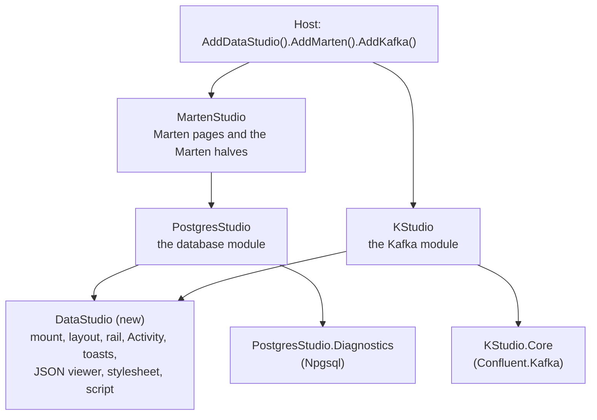

# A studio shell that Postgres, Marten and Kafka attach to

Today the shell and the Postgres pages are one package, `PostgresStudio`. Marten Studio is that package with a Marten
descriptor, and KStudio is a guest in it (D34). So a Kafka-only host must call `AddPostgresStudio()`, ships Npgsql and
the diagnostics engine, and draws Postgres Studio's rail with no database behind it; and Kafka pages can only live under
the database studio's path (issue #78).

After this work there is one shell package with no database in it. Postgres, Marten and Kafka are modules that attach to
it, alone or together, and a host registers them in one statement. `AddMartenStudio()`, `AddPostgresStudio()` and
`AddKafkaStudio()` keep working, with the same addresses and the same words.

## What changes

### The packages



The one edge that disappears is `KStudio → PostgresStudio`.
`KStudio.Wolverine`, `KStudio.Core` and `PostgresStudio.Diagnostics` do not move.

### The shell package

A Razor Class Library with `FrameworkReference Microsoft.AspNetCore.App` and `Microsoft.AspNetCore.App.Internal.Assets`
(D22), and nothing else: no Npgsql, Marten, JasperFx, Weasel, Confluent or Wolverine, held by a fence test like
`PostgresStudioFenceTests`.

| Moves to the shell (from `src/PostgresStudio`) | Stays in `PostgresStudio` |
|---|---|
| `Internal/StudioEndpointMapper` and the startup authorization guard (D11) | Every page under `Components/Pages/` except Activity and the home page |
| `Components/StudioDocument.razor`, `StudioRoutes.razor`, `StudioRouteTable`, `StudioLink` | `ScopeSelector`, `FindBox` and its contributors |
| `Components/Layout/` (layout, `NavMenu`, capability chip, preferences, environment badge) | `StudioState`'s scope half, `StudioScopeCatalog`, `StudioAuthorization`, `StudioCapabilityGuard` |
| The generic parts of `Components/Shared/` (`TableScroll`, dialogs, spinner, toasts, shortcut sheet) | The SQL and pgvector components of `Components/Shared/` |
| `Components/Json/` and `Services/Json/` (KStudio already uses `JsonView`) | The health, console, browser, sessions and connection services |
| `StudioActionLogService`, `StudioActionLog`, the Activity page, `ToastService`, `StudioLiveUpdates` | The database's own audit gate and log events |
| `IStudioModule`, the composition, `IStudioRouteLinks`, `IStudioRecordSearchLinks` | `IStudioLinks`, the Marten-facing seams (D12, D30) |
| `wwwroot/css/studio.css`, `wwwroot/js/studio.js` (served from `_content/DataStudio/`) | nothing: there is still exactly one stylesheet (hard rule 3, D26) |

None of the files in the left column names Npgsql today (checked), but they do name `StudioScope` (67 times),
`TenantList` and `IStudioSource`. That is the real work: the shell must stop knowing what a store, a database or a tenant
is. Three types are split for it:

- `StudioState` becomes `StudioPreferences` (theme, time zone: the shell's) and the scope state (the database module's).
- `StudioDescriptor` becomes the shell's descriptor (pages, rail, routes, modules) and the database's
  (`OverviewComponent`, `QueryComponent`, `CreateResource`, the source nouns), which still derives from
  `DiagnosticsDescriptor`.
- `IStudioSettings` gets a base, `IShellSettings` (`Title`, the path triple, `ApplicationPath`, `AuthorizationPolicy`,
  `ReadOnly`), which is all the shell reads.

### Every target is a module

`IStudioModule` (internal, D34) already gives a module its pages, rail sections, scope selector, capabilities, words and
audit gate. It gains what the layout hard-codes for the host studio today, and the database implements it:

```csharp
internal interface IStudioModule
{
    // today: Key, ProductName, Pages, Navigation, ScopeSelector, ExposedSentence,
    //        CapabilitiesHeading, Capabilities, Shortcuts, AuditEventIds

    /// The component that decides whether the visitor gets the page's body (the database's scope gate; null for none).
    Type? ScopeGate { get; }

    /// The header's centre component on this module's pages (the database's Find box; null for none).
    Type? HeaderSearch { get; }

    /// The route the shell's front page opens when this is the first module.
    string HomeRoute { get; }

    /// Whether this module's pages sit directly under the mount (at most one module: the database).
    bool IsRoot { get; }
}
```

`StudioLayout` then has no `currentModule is null` branch: it asks the module of the page on screen. The database's audit
entries get a scope kind and their own `IStudioAuditScopeGate`, like Kafka's, instead of being the ring's default. The
shell appends Activity to the last rail section, or adds a System section when no module has one.

Marten is not a second database module. `AddMarten()` registers the database module with Marten's descriptor, source
provider and contributors, exactly as `AddMartenStudio()` does today through `StudioCoreRegistration`. One database
module per shell: Marten or plain Postgres.

### Registration

```csharp
// New: any combination, one shell.
builder.Services
    .AddDataStudio(studio =>
    {
        studio.Path = "/admin";
        studio.AuthorizationPolicy = "ops";
    })
    .AddMarten(marten => marten.Capabilities = MartenStudioCapabilities.All())
    .AddKafka(kafka => kafka.AddCluster("orders", consumerConfig));

app.MapDataStudio();

// Kafka alone: no Npgsql, no diagnostics engine in the deployment.
builder.Services.AddDataStudio().AddKafka(kafka => kafka.AddCluster("orders", consumerConfig));

// Unchanged, and still the shortest spelling for one studio.
builder.Services.AddMartenStudio(o => o.Path = "/marten");
app.MapMartenStudio();
```

`AddDataStudio()` returns a `DataStudioBuilder` (it holds `Services`), and each package adds its own extension to it:
`AddPostgres(Action<PostgresStudioOptions>)`, `AddMarten(Action<MartenStudioOptions>)`,
`AddKafka(Action<KafkaStudioOptions>)`. The rules:

| Case | What happens |
|---|---|
| `AddMartenStudio()` / `AddPostgresStudio()` | Registers the shell too, whose settings read the studio's own options live, as `IStudioSettings` does today. Same path, title, words. |
| `AddDataStudio().AddMarten(…)` | The shell reads `DataStudioOptions`. `MartenStudioOptions.Path`, `Title`, `AuthorizationPolicy` and `ApplicationPath` set to a non-default value are refused at startup, naming the shell's option. |
| `ReadOnly` | The shell's turns every module's capabilities off. A module's own applies to that module. |
| `AddKafkaStudio()` | Still joins whichever shell is registered (order-independent, D34). `AddKafka()` on the builder calls it. |
| `.AddMarten().AddPostgres()` | Refused, as `AddMartenStudio()` beside `AddPostgresStudio()` is today. |
| `AddDataStudio()` beside `AddMartenStudio()` | Refused with one sentence: use `AddDataStudio().AddMarten()`. |
| `Map*Studio()` | Each requires its own `Add*`; the refusal names the right call. |

The startup guard's words under a legacy call are today's, to the byte; under `AddDataStudio()` they are the shell's, with
one sentence per module (`ExposedSentence`).

### Addresses

| Host | Addresses |
|---|---|
| `AddMartenStudio()` (unchanged) | `/marten`, `/marten/documents`, `/marten/health` |
| `AddMartenStudio()` + `AddKafkaStudio()` (unchanged) | the above, and `/marten/kafka/topic` |
| `AddDataStudio(Path = "/admin").AddMarten().AddKafka()` | after phase B: `/admin/documents`, `/admin/health`, `/admin/kafka/topic`; after phase C: `/admin/marten/documents`, `/admin/marten/health`, `/admin/kafka/topic` |
| `AddDataStudio().AddKafka()` | `/studio` redirects to `/studio/kafka`; `/studio/activity` |

Under a legacy call the database module stays the root module for good, so no existing address changes. Under
`AddDataStudio()` it gets a segment of its own in phase C (step 17): `marten` for Marten, `postgres` for plain Postgres.
The default path of `AddDataStudio()` is `/studio`.

### How modules collaborate

Nothing new is invented here; the existing seams are sorted into two levels.

- **Marten into Postgres** stays what it is: internal seams reached through `InternalsVisibleTo` and an exact pin (find
  contributors, plan insights, connection insights, health checks, relationship nodes, nav indicators). Marten gets every
  Postgres page over its own databases.
- **Between unrelated modules** goes through the shell: `IStudioRouteLinks` and `IStudioRecordSearchLinks` (D44) move
  there, so "Find in Kafka" on a Marten record and the document link on a Kafka record work without either naming the
  other. The Activity ring, the capability chip, the anonymous banner and the rail are composed from every module.

The seams stay internal. There is no public plug-in API (D30's reasoning holds).

## Steps

Phase A changes no package, no public type and no word. It can ship in any release, and it makes phase B a move.

**Phase A: the database becomes a module, inside `PostgresStudio`**

- [x] 1. Before any change, capture the prerendered rail and header of the three samples' pages as a golden file per
      sample, in a test that phase A must keep green.
- [x] 2. Split `Services/StudioState.cs` into `StudioPreferences` and the scope state; `StudioLayout` and
      `PreferencesMenu` read the first.
- [x] 3. Add `IShellSettings` under `IStudioSettings` and switch the files of the left column above to it.
- [x] 4. Split `StudioDescriptor` into the shell's and the database's; `StudioModuleComposition` composes the shell's from
      modules only.
- [ ] 5. Extend `IStudioModule` (`ScopeGate`, `HeaderSearch`, `HomeRoute`, `IsRoot`) and add `DatabaseStudioModule` in
      `PostgresStudio`, built from either descriptor. Move the layout's scope gate and address rewrite into its
      `ScopeGate` component.
- [ ] 6. Give the database's audit entries a scope kind and register its `IStudioAuditScopeGate`; the ring has no default
      gate left.
- [ ] 7. Move the shell's files to `src/PostgresStudio/Shell/` in the shell's final namespace, and add `ShellFenceTests`:
      no file there names Npgsql, `StudioScope`, a source or tenant type, or an engine namespace.

**Phase B: the package and the registration**

- [ ] 8. Create `src/DataStudio/` and move `Shell/`, `wwwroot/`, the JSON toolkit and the assets-pack reference into it.
      `PostgresStudio` and `KStudio` reference it, each packed with an exact pin and a version guard, as D30 does.
- [ ] 9. Give the shell its own copies of the pure helpers it takes from the engine (`StudioLogValue`, `StudioPath`,
      `StudioLogThrottle`), with parity tests, as `KStudio.Core` already does for log values.
- [ ] 10. Add `AddDataStudio`, `DataStudioBuilder`, `DataStudioOptions`, `MapDataStudio`, and the three `Add…` builder
      extensions; make the legacy calls register the shell through a settings adapter. Implement the rules table.
- [ ] 11. Remove `KStudio`'s reference to `PostgresStudio`; `KafkaStudioStartupGuard` asks for a shell, not a studio.
      Extend `KStudio`'s fences: no Npgsql, no `PostgresStudio*`.
- [ ] 12. Serve the assets from `_content/DataStudio/`; update the mapper's mirror, `NoJsInitializerTests` and the
      samples' test file providers.
- [ ] 13. Add `tests/DataStudio.Tests` (the shell with fake modules; `PostgresStudio.Tests/Modules` moves there), the
      public API baseline, and Kafka-only endpoint tests whose output folder holds no Npgsql.
- [ ] 14. Generate `CompatibilitySuppressions.xml` for the Razor components that left `PostgresStudio` (not a contract,
      `docs/stability.md`); delete it one release later.
- [ ] 15. Package ids (decided 2026-11-16): the assemblies and packages become `DataStudio.Postgres`,
      `DataStudio.Marten`, `DataStudio.Kafka`, `DataStudio.Kafka.Core` and `DataStudio.Kafka.Wolverine`, namespaces
      unchanged. `PostgresStudio` and `MartenStudio` stay as packages whose assembly holds only `[TypeForwardedTo]` for
      each public type, with an exact dependency on the new id; the three `KStudio*` ids are not kept (previews).
      Every `InternalsVisibleTo`, version guard, fence test, `postgres-studio.slnf` entry and `_content/` path follows
      the assembly names. Write this step's design before step 8 starts: it decides the project names step 8 creates.
- [ ] 15b. Build: `Pack` and `Publish` handle nine packages (the engine, the shell, the three modules, the two Kafka
      companions, the two forwarding packages); assert every pin in the nuspecs. The nuget.org trusted-publishing
      policy for each new id is a one-time step of yours.
- [ ] 16. Docs and samples: `samples/KStudio.Sample` uses the composed form; README, `docs/kstudio.md`,
      `docs/upgrading.md`, `docs/stability.md`, `AGENTS.md` (introduction, D11, D12, D16, D30, D34, hard rules 7 and 16,
      the budget table, *Build*), `docs/maintainers/layout.md`, `architecture.md`, `kstudio.md`, and `CHANGELOG.md`.

**Phase C: addresses (issue #78)**

- [ ] 17. Under `AddDataStudio()`, the database module keeps its root as a segment (`/admin/marten/documents`, or
      `/admin/postgres/health` in a plain Postgres host); under a legacy call it stays the root module.
      `StudioPageRoutes.BaseRelative` is the one place a database route becomes an href; it,
      the route table (`KeepsRoot`), the scope-query rewrite and the rail's active match take the segment. D31's
      mount-relative `StudioPath` then means "relative to the database module's root".
- [ ] 18. Run both browser suites over a composed host with the segment as well, and say in `docs/upgrading.md` what an
      address looks like under each registration.
- [ ] 19. Close #78 with the documented answer: mount the shell at `/admin`, and the pages are at `/admin/marten` and
      `/admin/kafka`.

## How it is verified

- [ ] After phase A: all seven suites green at the Marten floor and latest and the Npgsql latest pass; no `.verified.txt`
      moved; `StudioTextPinTests` and step 1's golden files unchanged; both browser suites green.
- [ ] After phase B: the three existing public API baselines only gain the builder extension; the new baseline holds
      exactly `AddDataStudio`, `DataStudioBuilder`, `DataStudioOptions` and `MapDataStudio`.
- [ ] A host with `AddDataStudio().AddKafka()` starts, serves `/studio/kafka`, and its output folder has no `Npgsql.dll`
      and no `PostgresStudio*.dll`.
- [ ] `samples/MartenStudio.Sample` and `samples/PostgresStudio.Sample` are not edited and their browser suites pass.
- [ ] `dotnet fallout Pack`, then `dotnet fallout Publish --skip`: nine packages, each pin asserted.
- [ ] A host that references only `MartenStudio` (the forwarding package) at the new version builds and runs
      `samples/MartenStudio.Sample` unchanged; the same for `PostgresStudio`.
- [ ] `studio-ui-verifier` on the three samples: rail, header, Activity and the capability chip in each shape.

## Decisions

| Decision | Choice | Why |
| --- | --- | --- |
| The shell's name | `DataStudio`: `AddDataStudio()`, `MapDataStudio()`, default path `/studio` | Decided in review. The id was unclaimed on nuget.org on 2026-11-14. |
| Where the shell lives | A package of its own | A Kafka-only host should not ship a database driver, and the modules become symmetric. |
| Builder shape | `AddDataStudio(o => …)` returns a builder; `.AddMarten()` chained | The ASP.NET Core idiom (`AddAuthentication().AddCookie()`), and each package can add its extension without the shell naming it. |
| The existing `Add*Studio` / `Map*Studio` | Kept, not obsolete | The public contract (`docs/stability.md`), and the shortest spelling for one studio. |
| Seams | Internal, `InternalsVisibleTo`, exact pins | D30: a public plug-in API multiplies the surface for a model nobody asked for. |
| Database modules per shell | One: Marten or Postgres | Settings, descriptor, source provider and sweep cache are single registrations today. Mixing them is a later plan of its own (decided in review). |
| A segment for the database module | Yes, in phase C, under `AddDataStudio()` only | Decided in review: `/admin/marten/…` beside `/admin/kafka/…` is what #78 asks for. |
| Shared helpers | Copied into the shell with parity tests | The alternative is an eighth package, pinned and guarded, for three small static classes. |
| Order | Phase A first, alone | The risky part (layout, scope, audit) lands with nothing else moving, and is bisectable. |
| Release | Minor releases; no major | No public member is removed. KStudio stays a preview and may change. |
| Package ids | `DataStudio`, `DataStudio.Postgres`, `DataStudio.Marten`, `DataStudio.Kafka`, `DataStudio.Kafka.Core`, `DataStudio.Kafka.Wolverine`; `PostgresStudio.Diagnostics` unchanged | Decided 2026-11-16: one family on nuget.org, the shell visibly the base. |
| The published ids `PostgresStudio` and `MartenStudio` | Kept as packages that depend on the new ids and forward their public types | An existing host upgrades with no source change (`docs/stability.md`). |
| Namespaces | Unchanged (`MartenStudio`, `PostgresStudio`, `KStudio`) | Decided 2026-11-16: the rename is packaging only. |

No decision is open: the review of 2026-11-14 settled the name, the segment and the mixed host, and the package ids
were settled on 2026-11-16.

## Risks

- Phase C touches every link path of the database module, and changes what D31's mount-relative `StudioPath` is relative
  to under `AddDataStudio()`. It is its own phase, after B has shipped, and step 18 is its gate; a legacy registration is
  not affected.

- Phase A edits the layout's scope and navigation code, which had subtle races in 1.2. It must change no behaviour:
  step 1's golden files and both browser suites are the gate, and each of steps 2 to 6 is a packet reviewed on its own.
- Moving public Razor components trips package validation (CP0001) against the 1.3 baseline. Step 14 covers it; run
  `Pack` after step 8, not at the release.
- Nine packages mean more exact pins and guards to keep true. They follow the one pattern D30 already has.
- The forwarding packages make `MartenStudio.dll` a different assembly than the one that holds the types: a host that
  reflects over it by assembly name finds nothing. `docs/upgrading.md` says so.
- A host that names `_content/PostgresStudio/` itself (a CSP rule, a proxy rule) breaks at step 12. The mirror under the
  mount is the documented path; `docs/upgrading.md` says so.

## Out of scope

- Marten stores and plain `NpgsqlDataSource`s attached to one shell: a plan of its own, later.
- A public extension API for third-party modules.
- Two shells in one process, or a shell hosted inside the host's own Blazor application (D11).
- The JSON API of issue #58.
- Renaming a namespace or a public type, or moving anything out of `PostgresStudio.Diagnostics` or the Kafka engine.

<details><summary>Evidence behind the plan</summary>

- `tests/KStudio.Tests/Endpoints/KafkaEndpointTests.cs`: a Kafka host today is `AddPostgresStudio()` plus
  `AddKafkaStudio()`, with or without a data source, served at `/postgres/kafka`.
- `src/KStudio/KStudio.csproj` references `PostgresStudio`; what KStudio takes from it is shell only: `StudioLogValue`,
  `TableScroll`, `StudioLiveUpdates`, `IStudioSettings`, `StudioState` (preferences), `JsonView`, the module and link
  seams, `StudioActionLog`, `ToastService`.
- `src/PostgresStudio/Services/Settings/StudioModule.cs` and `StudioDescriptor.cs`: the module seam and the
  composition, with `KeepsRoot` already distinguishing a module's routes from the host's.
- `src/PostgresStudio/Services/Settings/StudioRegistrationMarker.cs`: "one studio per process", with the remark that the
  seams for more exist.
- `src/PostgresStudio.Diagnostics/Services/StudioPageRoutes.cs`: `BaseRelative(route) => route` is the single place a
  database route becomes an href.
- `docs/stability.md`: page addresses, internal types and Razor components are not a contract; the public API is.

</details>
