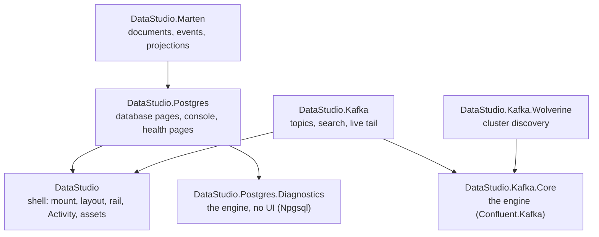

# DataStudio 2.0: one shell, three modules, clean names

1.x grew as Marten Studio, then Postgres Studio under it, then KStudio as a guest. The names, the registration calls and
the addresses still tell that history. 2.0 tells the product instead: **DataStudio** is an admin shell a host mounts
once, and Postgres, Marten and Kafka are modules that attach to it, alone or together. Nothing of 1.x has to survive
(decided 2026-11-16): no old package ids, no `AddMartenStudio()`, no forwarding assemblies.

Phase A of `2026-11-14-studio-shell-and-modules.md` already made the database a module and put the shell's code in its
own folder behind a fence. This plan starts from that branch.

## What changes

### The packages



| 1.x package | 2.0 package | Assembly and root namespace |
|---|---|---|
| (inside `PostgresStudio`) | `DataStudio` | `DataStudio` |
| `PostgresStudio` | `DataStudio.Postgres` | `DataStudio.Postgres` |
| `PostgresStudio.Diagnostics` | `DataStudio.Postgres.Diagnostics` | assembly `DataStudio.Postgres.Diagnostics`, namespace `DataStudio.Postgres` (shared with the module, as today) |
| `MartenStudio` | `DataStudio.Marten` | `DataStudio.Marten` |
| `KStudio` | `DataStudio.Kafka` | `DataStudio.Kafka` |
| `KStudio.Core` | `DataStudio.Kafka.Core` | `DataStudio.Kafka` (as today: one namespace over two assemblies) |
| `KStudio.Wolverine` | `DataStudio.Kafka.Wolverine` | `DataStudio.Kafka` |

All seven ship at one version, each pinned exactly to the ones below it, with the startup version guards 1.x has. The
Kafka three stay a preview in 2.0 (`KStudioPrereleaseLabel` becomes `KafkaPrereleaseLabel`, still `preview.1`).
The old ids get no 2.0 release; they are deprecated on nuget.org with a pointer to their successor.

### What a host writes

```csharp
using DataStudio;                       // every installed module's Add… method is in this namespace

builder.Services
    .AddDataStudio(studio =>
    {
        studio.Path = "/admin";                 // default "/studio"
        studio.AuthorizationPolicy = "ops";
        studio.ReadOnly = false;
    })
    .AddMarten(marten => marten.Capabilities = MartenCapabilities.All())
    .AddKafka(kafka => kafka.AddCluster("orders", consumerConfig));

app.MapDataStudio();                            // or MapDataStudio("/admin").RequireAuthorization()

// A worker with no UI:
builder.Services.AddPostgresDiagnostics();
builder.Services.AddHealthChecks().AddPostgresDiagnostics(tags: ["postgres"]);
```

The public surface, package by package:

| Package | Public types |
|---|---|
| `DataStudio` | `AddDataStudio`, `MapDataStudio`, `DataStudioBuilder` (holds `Services`), `DataStudioOptions` (`Path`, `Title`, `ApplicationPath`, `AuthorizationPolicy`, `ReadOnly`, `RefreshInterval`) |
| `DataStudio.Postgres` | `AddPostgres(this DataStudioBuilder, …)`, `PostgresOptions`, `PostgresCapabilities`, `PostgresResource` |
| `DataStudio.Postgres.Diagnostics` | `AddPostgresDiagnostics`, `PostgresDiagnosticsOptions`, `IPostgresDiagnostics` and the read model, the two source interfaces, the connection history's four types; `PostgresStudioLink` and `PostgresStudioPage` become `PostgresPageLink` and `PostgresPage` |
| `DataStudio.Marten` | `AddMarten(this DataStudioBuilder, …)`, `MartenOptions`, `MartenCapabilities`, `MartenStoreResource`, `ProjectionLagThreshold` |
| `DataStudio.Kafka` | `AddKafka(this DataStudioBuilder, …)`, `KafkaOptions`, `KafkaCapabilities`, `KafkaTopicResource` |
| `DataStudio.Kafka.Core` | the builders, limits, decoders and index seam it has today, names unchanged (they already start with `Kafka`) |
| `DataStudio.Kafka.Wolverine` | `UseWolverineKafka`, `KafkaWolverineOptions` |

Rules a host can rely on:

- **One shell per application.** `AddDataStudio()` and each module's `Add…()` are idempotent: called twice, they
  configure the options twice and register once.
- **The shell's options are the shell's.** A module's options have no `Path`, `Title` or `AuthorizationPolicy`. The
  shell's `ReadOnly` turns every module's capabilities off; a module keeps a `ReadOnly` of its own.
- **`AddMarten()` brings the Postgres pages** over the Marten stores' databases; it needs `DataStudio.Postgres` and
  registers that module itself. `AddMarten()` beside `AddPostgres()` is refused in 2.0 (see *Out of scope*).
- **Two read-only switches.** The shell's turns every module off. A module's own turns only that module off: unlike
  1.x, `MartenOptions.ReadOnly` no longer turns the Kafka capabilities off (`docs/upgrading.md` says so).
- **Nothing connects at registration**, and a host that adds the packages and never calls `MapDataStudio()` is the
  application it was. That constraint of 1.x stays.

### Addresses

Every module sits under a segment of its own, and the shell owns the rest. There is no root module any more.

| Page | Address under the mount `/studio` |
|---|---|
| Front page | `/studio`: one tile per module (name, a sentence, a link), or a redirect when there is one module |
| Activity | `/studio/activity` |
| Marten | `/studio/marten/documents`, `/studio/marten/streams`, `/studio/marten/projections`, … |
| Postgres (also in a Marten host, over its databases) | `/studio/postgres/health`, `/studio/postgres/tables`, `/studio/postgres/query`, … |
| Kafka | `/studio/kafka/topics`, `/studio/kafka/search`, … |

Scope and ids still travel in the query string (D9). This closes issue #78.

### The architecture, cleaned up

Phase A left a few things that only existed to keep 1.x unchanged. 2.0 removes them:

- **`IsRoot` goes.** With every module under a segment, the layout has one path: the module of the page on screen. The
  rail's credit, the route table (`KeepsRoot`) and the composition lose their special cases.
- **One wording.** `StudioProduct` picks between two sets of sentences and two copies of every shared log template
  (`StudioLog`, `PostgresStudioLog`), kept so that Marten Studio's 0.4 words never moved. 2.0 has one set, in the
  module that says it; the source nouns ("Marten store", "data source") stay as descriptor data.
- **The capability chip has one row template**, and the anonymous banner is one sentence per module.
- **Keyboard shortcuts** for the SQL editor, the JSON viewer, table rows and the plan view are contributed by the
  Postgres module, not listed in the shell.
- **The shell's assets** are served from `_content/DataStudio/`. There is still exactly one stylesheet.
- **The fence becomes the assembly.** `DataStudio` references ASP.NET Core and nothing else; `DataStudio.Kafka`
  references no Npgsql and no `DataStudio.Postgres*`. The two engine helpers the shell still borrows
  (`StudioPageRoutes`, `StudioLogThrottle`) get shell-side copies with parity tests.

Not renamed: the `ms-` CSS prefix, the `martenStudio` script global and the two preference cookie names. They are
internal, a visitor's saved theme survives, and renaming 17,000 lines of CSS buys nothing.

## Steps

Each step ends with every suite it can reach green. Steps 1 to 3 change no behaviour; 4 to 7 are the visible 2.0.

- [x] 1. **Freeze the public API.** Write `docs/maintainers/v2-public-api.md`: every public type and member of the table
      above, with its 1.x name beside it. Review it before step 4; steps 2 and 3 do not depend on it.
- [x] 2. **Rename projects, assemblies and namespaces**, one project per commit, mechanically (`git mv`, a scripted
      namespace rewrite, the Roslyn rename tools for types): `src/PostgresStudio.Diagnostics` →
      `src/DataStudio.Postgres.Diagnostics`, `src/PostgresStudio` → `src/DataStudio.Postgres`, `src/MartenStudio` →
      `src/DataStudio.Marten`, `src/KStudio.Core` → `src/DataStudio.Kafka.Core`, `src/KStudio` → `src/DataStudio.Kafka`,
      `src/KStudio.Wolverine` → `src/DataStudio.Kafka.Wolverine`; the seven test projects and the samples follow
      (`tests/DataStudio.Marten.Tests`, `samples/DataStudio.Sample.Marten`, …). Every `InternalsVisibleTo`, version
      guard, fence, `postgres-studio.slnf` (→ `datastudio-postgres.slnf`), MSBuild property name and
      `docs/maintainers/layout.md` row follows, and `marten-studio.slnx` becomes `data-studio.slnx` (the build scripts,
      the workflows' attributes and the docs that name it follow). Public type names do not change in this step.
- [x] 3. **Extract `src/DataStudio`** from `src/DataStudio.Postgres/Shell/`: the folder, `wwwroot/`, the JSON toolkit
      (`Components/Json`, `Services/Json`) and the `Microsoft.AspNetCore.App.Internal.Assets` reference. Copy the two
      engine helpers with parity tests. `DataStudio.Postgres` and `DataStudio.Kafka` reference it with an exact pin and
      a version guard. `DataStudio.Kafka` drops its reference to `DataStudio.Postgres`. New `tests/DataStudio.Tests`
      (the shell with fake modules). `ShellFenceTests` becomes a reference check.
- [x] 4. **The registration.** `AddDataStudio`, `DataStudioBuilder`, `DataStudioOptions`, `MapDataStudio`; the three
      `Add…` builder extensions; the options split of the table above; the startup guards reworded for one shell. Delete
      `AddMartenStudio`, `AddPostgresStudio`, `AddKafkaStudio` and their `Map…` calls. Apply the public renames of
      step 1 (`MartenStudioOptions` → `MartenOptions`, and so on). The four public API baselines are replaced, reviewed
      line by line.
- [x] 5. **Addresses.** Every module keeps its root as a segment; remove `IsRoot`; `StudioPageRoutes.BaseRelative`, the
      route table, the scope-query rewrite and the rail's active match take the Postgres segment; the diagnostics read
      model's page paths stay relative to the mount and start with `postgres/`. The shell's front page (a tile per
      module, or a redirect when there is one) and `/studio/activity`. The tiles carry a name, a sentence and a link:
      headline numbers need a gated read per module and are a follow-up.
- [x] 6. **One wording.** Remove `StudioProduct`, merge `StudioLog` and `PostgresStudioLog` (same event ids, one
      template each), move module-specific sentences to their module, retire `StudioTextPinTests`. Shortcuts move to
      the Postgres module; the chip and the banner get their single templates.
- [x] 7. **Golden files and browser suites.** Re-accept the shell's golden files once, after steps 4 to 6, reading the
      diff; both browser suites and the Kafka shell live tests over the new addresses; a Kafka-only host test whose
      output folder holds no `Npgsql.dll` and no `DataStudio.Postgres*.dll`.
- [x] 8. **Build and packaging.** `Pack` and `Publish` handle the seven packages in dependency order and assert every
      pin; `PackageValidationBaselineVersion` is removed (no baseline exists for the new ids) and set again after 2.0;
      the workflows are regenerated from the attributes (hard rule 2).
- [ ] 9. **Documentation.** README (one product, three modules), each package's README, `docs/upgrading.md` (a 1.x → 2.0
      table: package, registration call, option, address, log category), `docs/stability.md`, `docs/kstudio.md` →
      `docs/kafka.md`, AGENTS.md and `docs/maintainers/*` rewritten for the new names (the D-numbers stay; D11, D12, D30,
      D34 and hard rules 7 and 16 are restated), `CHANGELOG.md` `# 2.0.0`, `Directory.Build.props` `VersionPrefix`.
- [ ] 10. **Release.** (Owner, 2026-11-17: ship `2.0.0-beta.1` first, tag and nuget.org included, to dogfood in real
      projects; `2.0.0` follows after feedback. All seven packages are `2.0.0-beta.1` in the beta.) Full `build.ps1 Test` at the floors and at the latest-tested versions, `Pack`, `Publish --skip`,
      the `studio-ui-verifier` over the three samples, then the tag. The existing nuget.org trusted-publishing policy
      is not limited to one package id (`docs/maintainers/build-and-release.md`), so the seven new ids need no new
      policy; the owner confirms that before the tag. After it: deprecate the six old ids with their successors.

## How it is verified

- [ ] After steps 2 and 3: every suite green with no expected value changed; `git diff -M` shows renames and `using`
      lines only.
- [ ] After step 4: a host can be written from the README alone; no `…Studio` registration name remains in `src/`.
- [ ] After step 5: every sample's rail link opens its page, and a pasted 1.x address is a 404, not a wrong page.
- [ ] A host with `AddDataStudio().AddKafka()` starts and serves `/studio/kafka/topics` with no Npgsql in its output.
- [ ] `dotnet fallout Pack` then `dotnet fallout Publish --skip`: seven packages, every pin asserted.

## Decisions

| Decision | Choice | Why |
| --- | --- | --- |
| Product and package family | `DataStudio`, seven packages | Decided 2026-11-16. |
| Legacy | None: no old ids, calls, addresses or forwarding | Decided 2026-11-16: "drop legacy and aim for optimal APIs and naming". |
| The engine's id | `DataStudio.Postgres.Diagnostics` | It is usable alone, so it keeps a name that says what it is; only the family prefix changes. |
| Option and capability names | `PostgresOptions`, `MartenOptions`, `KafkaOptions`, `…Capabilities` | Decided 2026-11-16. The package and the `Add…` call already say "DataStudio"; "Studio" in every type name is noise. |
| Where the `Add…` extensions live | Namespace `DataStudio`, in each module's assembly | One `using` lights up every installed module. |
| Seams between modules | Internal, `InternalsVisibleTo`, exact pins | A public plug-in API is still a surface nobody asked for. |
| Order | Rename, then extract, then change behaviour | Two mechanical steps that tests can prove, before anything a visitor sees moves. |
| CSS prefix, script global, cookie names | Kept | Internal, and a saved theme survives. |
| One wording | Yes: no sentence or log message of 1.x has to stay | Decided 2026-11-16. |
| The solution file | `marten-studio.slnx` becomes `data-studio.slnx` (step 2); the repository's own name is the owner's to change on GitHub | Decided 2026-11-16. |
| Kafka's three packages | Stay a preview: `2.0.0-preview.1` beside the family's `2.0.0` | Decided 2026-11-16. |

No decision is open: the option names, the one wording, the solution file and the Kafka label were settled on 2026-11-16.

## Risks

- **Step 2 touches almost every file.** It is safe only as pure renames: one project per commit, no other edit in the
  same commit, suites after each.
- **Step 5 changes every link of the Postgres module.** `StudioPageRoutes.BaseRelative` is the one place a route
  becomes an href, but pushes and redirects built by hand exist; both browser suites are the gate.
- **The diagnostics API's page paths change meaning** (relative to the Postgres module, not to the mount). A host that
  builds links from them must prefix the segment; `docs/upgrading.md` says so.
- **Seven new package ids go out under the one existing trusted-publishing policy**, which covers every id of the
  repository; if that turns out not to hold for a new id, the publish workflow fails half-way through the family, so
  the owner confirms it before the tag.

## Out of scope

- Marten stores and plain `NpgsqlDataSource`s in one host. The source kinds already tell them apart, so it can come in
  2.x without a new break.
- A public extension API for third-party modules.
- Renaming markup, CSS classes or the script global.
- The JSON API of issue #58.

## Starting fresh

If this is picked up in a new session, everything it needs is on disk:

- **Branch:** `alta/easy-denali-bbj2` in `D:\Work\marten-studio\.alta\worktrees\easy-denali-bbj2`, not pushed. Phase A
  is its last twenty-odd commits on top of `origin/main` `45bf46de` (1.3.1). Rebase onto `origin/main` first if main
  moved.
- **Known state of the branch:** every suite passes at the floors; `dotnet fallout Pack` fails package validation
  (27 CP0001, the Razor components phase A moved to `DataStudio.*` namespaces), which step 8 ends.
- **What phase A built:** `C:\Users\marko\.claude\plans\shell-orchestration\DESIGN-A.md` (the seam, section by
  section), `LEDGER.md` beside it (every session, verdict and accepted deviation), `reports\REVIEW-A*.md` (the
  reviewers' findings; A3's lists what is left for 2.0).
- **How the work is run:** `common.md` in that folder, on top of
  `C:\Users\marko\.claude\plans\kstudio-orchestration\child.md` and `common.md` (child rules, the quiet-window gate,
  resources). One Sonnet `studio-implementer` session per packet in a worktree of its own, an Opus `studio-reviewer`
  over each diff, cherry-pick onto the integration branch. Steps 2 and 3 are `studio-grunt` work once the rename table
  is written out.
- **Standing instructions** (memory): breaking changes are fine and no shim is kept; the product sits between pgAdmin
  and CritterWatch; post `BUSY` and `box free` to `D:\Work\.bench.queue` around heavy work.
- **Open beside this plan:** task `hpjq` (a Kafka wire contract live test that read `OffsetOutOfRange` once), and
  GitHub issues #78 (closed by step 5), #80 and #81.
