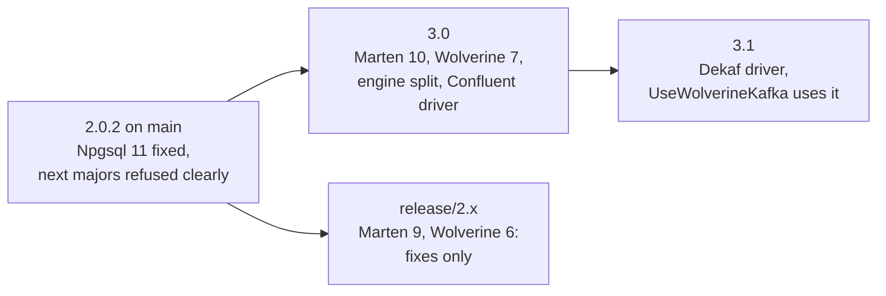

# Data Studio 3 for Marten 10 and Wolverine 7, and Dekaf as a second Kafka client

This plan answers three questions: what the open issues ask for, what it would mean to support Dekaf beside
Confluent.Kafka, and how Data Studio gets to Wolverine 7. Every fact below was read on 2026-11-28 from the sibling
checkouts (`D:\Work\wolverine` at `V7.0.0-rc.1` and `upstream/main`, `D:\Work\marten` at `V10.0.0-rc.3`, a new blobless
clone of Dekaf at `D:\Work\dekaf`, `D:\Work\librdkafka` and `D:\Work\npgsql` at `upstream`), from nuget.org, and from
scratch builds of this repository against the new versions. Nothing was committed.

## What is open

| Item | State | In this plan |
|---|---|---|
| #103 Support Wolverine 7 (Kafka on Dekaf) and Marten 10 | open since 2026-11-27 | steps 1 to 3 |
| #58 Should the Kafka module expose a JSON API? | a decision record, deferred on purpose | unchanged: nothing found today bears on it |
| task `2zrh` Raise the Confluent.Kafka floor past librdkafka #5611 | blocked | still blocked: #5611 is in librdkafka's *Unreleased* section, and 2.16.0 is the newest Confluent.Kafka 2.x. A host on the Dekaf driver (step 3) no longer runs that code at all. |

## What changed upstream

### Wolverine 7 (7.0.0-rc.1, 2026-11-24)

- `WolverineFx.Kafka` references `Dekaf`, `Dekaf.SchemaRegistry.Avro` and `Dekaf.SchemaRegistry.Json` 1.25.0, and no
  Confluent package.
- `KafkaTransport.ConsumerConfig`, `ProducerConfig` and `AdminClientConfig` are Wolverine's own `KafkaConsumerOptions`,
  `KafkaProducerOptions` and `KafkaAdminClientOptions` (`KafkaClientOptions.cs`). They hold `BootstrapServers`,
  `ClientId`, `UseTls`, `SaslMechanism` (Dekaf's enum), `SaslUsername` and `SaslPassword`. The consumer adds `GroupId`,
  `GroupInstanceId`, `AutoOffsetReset`, `IsolationLevel` and fetch sizes; the producer adds `EnableIdempotence`, `Acks`,
  `Linger`, `BatchSize` and `Partitioner`.
- Everything else lives only in the `ConfigureProducerBuilders`, `ConfigureConsumerBuilders` and
  `ConfigureAdminClientBuilders` callbacks on Dekaf's builders: custom certificates, mutual TLS, GSSAPI, OAuth, MSK IAM
  and timeouts. Wolverine itself refuses GSSAPI, OAuth and MSK IAM in `SaslMechanism` (`AssertSaslSupported`). The
  callbacks compose since #5999.
- The default partitioner is Dekaf's murmur2, as in the Java client. CRC32 (librdkafka's `consistent_random`) applies
  only after `RestoreV6Defaults()`, which is public as `WolverineOptions.V6DefaultsRestored`, and it is written at
  connect time (GH-6000).
- Broker-per-tenant registrations are still `internal`, through the three members our probe reads
  (`KafkaTransport.Tenants`, `KafkaTenant.TenantId`, `KafkaTenant.Transport`).
- Dekaf's group consumers speak only KIP-848, so a Wolverine 7 application that listens runs on Kafka 4.0 or later,
  and its groups use the `consumer` protocol. librdkafka has described those groups since 2.10, and
  `WireContractLiveTests` already reads one.
- It needs JasperFx 3.16. So does Marten 10.0.0-rc.3 (with Weasel 10), which brings **Npgsql 11.0.0** through
  `Weasel.Postgresql` 10. A Wolverine 7 host therefore runs Marten 10 and Npgsql 11; Marten 9 cannot share JasperFx 3.

### What breaks in Data Studio (scratch builds against the new versions)

| Build | Result |
|---|---|
| `DataStudio.Kafka.Wolverine` at WolverineFx.Kafka 7.0.0-rc.1 | Restore fails with NU1109: Dekaf 1.25 needs `Microsoft.Extensions.Logging.Abstractions` and `Options` 10.0.14, and the engine's central rows pin 10.0.0. With those rows raised, 3 compile errors: [WolverineClusterSource.cs](src/DataStudio.Kafka.Wolverine/Internal/WolverineClusterSource.cs#L249) copies the options as Confluent configs (lines 249-250), and [WolverineTopicReader.cs](src/DataStudio.Kafka.Wolverine/Internal/WolverineTopicReader.cs#L178) reads the partitioner from a Confluent `ClientConfig`. |
| `DataStudio.Marten` at Marten 10.0.0-rc.3 | 10 errors in 6 places, each with a replacement in Marten's migration guide. `UseStickyConnectionLifetimes` is gone ([MartenConnectionOptions.cs](src/DataStudio.Marten/Services/Connection/MartenConnectionOptions.cs#L81)). `IDocumentSession.Connection` becomes `GetConnectionAsync()` ([DocumentWriteService.cs](src/DataStudio.Marten/Services/Documents/DocumentWriteService.cs#L1381)). `GetPostgresVersion` becomes `GetPostgresVersionAsync` ([StoreInfoService.cs](src/DataStudio.Marten/Services/StoreInfoService.cs#L407)). `BadLinqExpressionException`, `UnknownEventTypeException` and `EventDeserializationFailureException` moved to JasperFx ([LinqQueryComposer.cs](src/DataStudio.Marten/Services/Query/LinqQueryComposer.cs#L330), [EventShapeCheckService.cs](src/DataStudio.Marten/Services/Shapes/EventShapeCheckService.cs#L717)). `NpgsqlConnectionStringBuilder.Multiplexing` is gone ([DaemonTimeoutsCheck.cs](src/DataStudio.Marten/Services/Health/Checks/DaemonTimeoutsCheck.cs#L256)). |
| `DataStudio.Postgres` at Npgsql 11.0.0 | 1 error: [PostgresPlatform.cs](src/DataStudio.Postgres.Diagnostics/Services/Health/PostgresPlatform.cs#L397) reads `Multiplexing`, which Npgsql 11 removed. |

> [!WARNING]
> The last row is a bug in 2.0.1 today, with or without Marten. Npgsql 11.0.0 shipped on 2026-11-20, and our Npgsql
> floor (9.0.4) has no upper bound. `DataSourceEndpoints.Of` catches only `ArgumentException`, so the
> `MissingMethodException` escapes from platform detection, which every health sweep runs
> ([PostgresPlatform.cs](src/DataStudio.Postgres.Diagnostics/Services/Health/PostgresPlatform.cs#L285)), and from
> [PostgresServerReader.cs](src/DataStudio.Postgres/Services/Postgres/PostgresServerReader.cs#L139).

Neither the Marten module nor the Wolverine adapter can serve both majors in one build. A member whose type changed
(Wolverine) or that is gone (Marten) fails at run time with `MissingMethodException`, and that is what #103 saw.
Marten 9 and Wolverine 6 stay with 2.x, and 3.0 is the line for Marten 10 and Wolverine 7.

### Dekaf (v1.29.0; Wolverine 7 pins 1.25.0)

It has what the wire seam ([IKafkaWire.cs](src/DataStudio.Kafka.Core/Wire/IKafkaWire.cs)) needs:

- a consumer with no group id;
- `Assign`, `IncrementalAssign`, `Pause`, `Resume` and `Seek`;
- zero-copy `ConsumeRawBatchAsync`, and partition end through `WithPartitionEof`;
- `AutoOffsetReset.None`, an explicit isolation level, and `WithAllowAutoCreateTopics(false)`;
- the admin reads: metadata, describe topics, cluster and configs, list offsets (`MaxTimestamp` included), describe
  groups (classic and `consumer`) and group offsets.

Where it differs:

- **The broker floor is Kafka 4.0**, manual assignment included (`docs/docs/consumer/consumer-groups.md`); its release
  gate runs Kafka 4.0.2 to 4.4.0. Kafka 3.x clusters need the Confluent driver.
- **It is async only.** Our scan reader is synchronous on the scan's own thread (`IWireScanReader.Read(TimeSpan)`).
- **Codecs are packages.** LZ4, Zstd and Snappy come as `Dekaf.Compression.*`, over K4os, ZstdSharp.Port and
  Snappier. The studio must read whatever a producer wrote, so a Dekaf driver takes all three.
- **It is managed code.** There is no librdkafka, so none of the native faults D36 works around (#5040, #4605) exist:
  a fault is an exception, not a dead process.
- **`ListConsumerGroupOffsetsAsync(group)` reads the whole group**, so we filter its partitions ourselves.
- **It has one maintainer**, the repository dates from January 2026, and 54 releases have shipped since. A Wolverine 7
  host already depends on it.

### Confluent.Kafka's next major

`Confluent.Kafka` 4.4.0-alpha.1 is a new client on a Rust core (`confluentinc/kafka-clients`), with an API modelled on
the Java client and the same package id. In its README's words, "a project gets one of them for its whole dependency
graph". Our floor, 2.14.0, has no upper bound, so the day a host takes 4.x, `DataStudio.Kafka.Core` breaks at run time
the way #103 describes.

## Supporting both clients: what it means

| | A. Confluent only (today) | B. Dekaf only | C. Both, one driver each |
|---|---|---|---|
| A Wolverine 7 host gets | librdkafka's native library beside Dekaf, with the process-level faults D36 documents | nothing new | nothing new (the Dekaf driver) |
| A host on Confluent.Kafka gets | nothing new | Dekaf beside Confluent | nothing new (the Confluent driver) |
| Kafka 3.x clusters | yes | no | with the Confluent driver |
| Authentication Wolverine 7 keeps in its callbacks | restated by the host in librdkafka's terms; MSK IAM has no librdkafka form | a hook on Dekaf's builder | as B, for Dekaf clusters |
| Work | translate Wolverine's options (small) | rewrite the wire, drop the Kafka 3.9 suites, break the public API | split the engine from its client, write a second wire, run the contract suite on both, two more packages |
| Afterwards | one client, and Confluent's 4.x rewrite ahead | one client, at Dekaf's pace | two clients and their faults, held by one contract suite |

**Recommendation: C, in two steps.** Data Studio's natural hosts are Marten and Wolverine applications (positioning
between pgAdmin and CritterWatch), and from Wolverine 7 their Kafka client is Dekaf. Making those hosts load librdkafka
for an admin page, with the crash D36 still documents, goes against "registering Data Studio must never change host
behaviour". The Confluent driver stays, for hosts already on Confluent.Kafka and for Kafka 3.x clusters. When
Confluent.Kafka 4 is ready, it becomes a third driver, not a rewrite of the engine.

The seam already exists for this: `IKafkaWire` carries no Confluent type and returns errors as values, and one contract
suite runs on the fake broker and on real Kafka 3.9 and 4.4 brokers (D36). Spec 0.2 designed exactly this split (B.4.2:
a client-free core and one driver package per client). Plan K2 deferred Dekaf only because of its Kafka 4.0 floor and
its age. Wolverine 7 now carries both of those risks itself.

Option B is not recommended: it drops Kafka 3.x clusters and pushes Dekaf into hosts that use Confluent.

What C takes:

1. **`DataStudio.Kafka.Core` holds no client.** Confluent types appear in six places outside `Wire/Confluent/`:
   `IKafkaClusterSource`, `KafkaClusterDefinition`, `KafkaEngineRegistration`, the settings catalog and reader,
   `KafkaClusterBuilder.OAuthBearerTokenRefresh` and `KafkaEngineOptions.AddCluster`. Each one takes a client-neutral
   connection instead: bootstrap servers, client id, TLS, SASL mechanism and credentials, and a token provider. That is
   also exactly what Wolverine 7's options say.
2. **`DataStudio.Kafka.Confluent`, a new package**, takes:
   - the 1,845 lines of `Wire/Confluent/`;
   - `AddCluster(key, ClientConfig)`, `OAuthBearerTokenRefresh` and `GroupIdPrefix`;
   - the librdkafka settings catalog;
   - the #5040 dependent admin client and the #4605 retire.
3. **`DataStudio.Kafka.Dekaf`, a new package**, holds:
   - an `IKafkaWire` on Dekaf, with errors as values;
   - D37's overrides in Dekaf's terms: no group, `WithAllowAutoCreateTopics(false)`, `AutoOffsetReset.None`, an
     explicit isolation level, `WithPartitionEof`, the engine's own fetch sizes and logger, and no interceptor;
   - the three codecs.
4. **The scan reader** becomes async, or Dekaf's reader blocks on the scan's own thread. The packet decides which.
5. **One driver per application.** The host calls `kafka.UseConfluent()` or `kafka.UseDekaf()`, and a startup guard
   refuses none or two.
6. **The suites run per driver.** The contract suite runs on the fake, on Confluent (Kafka 3.9 and 4.4) and on Dekaf
   (4.4 only). The read-never-writes suites and `ConfluentOverridesTests` each get a Dekaf twin. D41's
   $C \approx 64$ MiB per consumer, measured on librdkafka, is measured again on Dekaf.
7. **The fences move.** The core references no client, each driver only its own, the Kafka module no driver, and
   `DataStudio.Kafka.Wolverine` no Confluent.
8. **Nine packages instead of seven.** Each driver gets an exact pin and a version guard (the
   `KafkaWolverineVersionGuard` pattern) and a place in the pack order. The package budget gets entries for Dekaf, its
   codecs and what they bring, and `Microsoft.Extensions.*` 10.0.14 for the Kafka rows. D36, D37, D41 and D43 are
   rewritten and K2 is superseded, with `layout.md` rows and `docs/kafka.md`.

## Features worth supporting

Ranked by value to the studio's own users. None crosses into CritterWatch's territory (fleet, alerting, Wolverine
runtime control).

1. **Marten 10's parked identities** (3.0 or 3.1). Async projections now park a failing identity, or pause a shard,
   instead of skipping the event. Marten 10 adds `mt_parked_identities` and `parked_count` on `mt_event_progression`,
   and a shard that fails before its first commit gets a progression row at 0. The projection and daemon pages should
   show parked identities and paused shards. Replaying or discarding one is a capability-gated, audited write
   (hard rule 5), and a health check gets a code of its own in `docs/health/codes.md`. Our progression reads must
   also handle the new row at 0.
2. **The Dekaf driver** (3.1, above).
3. **Schema Registry decoding.** Wolverine 7 ships `SchemaRegistryAvroSerializer` and `SchemaRegistryJsonSerializer`,
   and their records arrive as a magic byte and a schema id, which our decoders show as undecodable. This is an
   `IKafkaRecordDecoder` behind its own package and budget entry, which the spec listed for 1.x. Discovery can name the
   serializer on a topic already.
4. **Marten 10's stream and projection operations**: `UnArchiveStream()` beside archiving, rebuilding one identity of a
   multi-stream projection, and lookup by natural key. Each is a capability-gated write or a read on the existing
   pages.
5. **Showing `RestoreV9Defaults()` and `RestoreV6Defaults()`** on the configuration pages, because they change what
   the daemon and the partitioner do.

## The path

- **2.0.2** helps every 2.x host now.
- **3.0 is forced** by the binary breaks, and should be ready when Wolverine 7 and Marten 10 go stable. It also does the
  engine split, so the public API breaks once, in a major. A Wolverine 7 host runs on the Confluent driver in 3.0.
- **3.1 is additive**: a new package and a new call.

If Wolverine 7 reaches GA before the split is ready, ship 3.0 without it: Wolverine 7 is then supported through the
Confluent engine, using the same neutral connection inside. 3.1 then moves `AddCluster(ClientConfig)` into the
Confluent package, which is a break in a minor (decision 3).

Routing follows D21. Each design-bearing packet goes to `studio-implementer` with its decisions written in, and
`studio-reviewer` reviews every packet that touches `src/`. Each worktree runs `git rebase origin/main` before it
starts. Heavy runs follow the quiet-window handshake.

## Steps

### Step 1: 2.0.2 on main

- [x] Read `Multiplexing` through the connection string's keywords, never the property, in one engine helper used by
      `DataSourceEndpoints.Of` and `DaemonTimeoutsCheck.SleepsInsteadOfKeepalive`; the Marten module reaches it through
      `InternalsVisibleTo`. On Npgsql 11 the keyword cannot be in a connection string, so the answer is `false`. Add a
      test on each path (task `43bf`).
- [x] Move `DataStudioNpgsqlLatest` to 11.0.0 and run the latest-Npgsql pass (`--npgsql-version latest`), fixing or
      recording every difference. Add a budget entry. The pass also takes `Microsoft.Extensions.*` at 11.0.0
      (`DataStudioExtensionsVersion`), which Npgsql 11 asks for; Pack stays at 10.0.0.
- [x] Make the next majors fail with a sentence, not at a random call (decision 1):
  - `AddMarten()` refuses Marten 10 or later and names Data Studio 3, as `PostgresVersionGuard` does.
  - The Wolverine source's note says "Wolverine 7 needs Data Studio 3". It checks the shape of `KafkaTransport`'s three
    configuration properties before any member is read, not a version: `Wolverine.Kafka.dll` is 0.0.0.0 in every release.
  - `AddKafka()` refuses Confluent.Kafka 3 or later, which includes the Rust-based 4.x.
- [ ] CHANGELOG 2.0.2 and the tag (patch releases are within the release authority).
- [ ] If decision 2 keeps a 2.x line: cut `release/2.x` at `v2.0.2`, and add it to `OnPushBranches` and
      `OnPullRequestBranches` in `build/Build.CI.GitHubActions.cs`, then regenerate (hard rule 2). Today CI runs on
      `main` only.

### Step 2: 3.0 (previews on the rc versions, stable after GA)

The Marten module:

- [ ] Marten floor `10.0.0-rc.3`, later `10.0.0`. Fix the 10 errors with the migration guide's replacements:
      `GetPostgresVersionAsync`, `session.GetConnectionAsync()`, the exception types from `JasperFx` and
      `JasperFx.Events`, the `Multiplexing` helper, and no sticky lifetimes (a session that needs one connection pins it
      with `GetConnectionAsync()`).
- [ ] Run the Marten suites (fast, integration and browser) at Marten 10. Its run-time changes show only there: LINQ
      results that differ, parking instead of skipping, the progression row at 0, natural keys.
- [ ] Re-check what JasperFx 3 changed: the source-generator drop target, D28's Dynamic LINQ, and the health checks
      that read the daemon.
- [ ] The Marten module's suites run on Npgsql 11. The Postgres module keeps its 9.0.4 floor and is tested at 9.0.4 and
      11.0.0 (`NpgsqlVersionTests`).
- [ ] C18 on Npgsql 11 (REVIEW-202-A, F1), where a pool is named after its data source's `Application Name`: the
      reason list and caveat of `SiblingPoolsCheck` and C01's unavailable text name the application name as a cause; when
      the sweep's own name has several reporters, the note says its pool shares that name with other pools of the process
      instead of "no pool it can identify connects"; the two C18 live tests run at 11 again (a sibling without an
      application name). The engine's words baseline moves.

Kafka:

- [ ] An internal, client-neutral connection description, carried by `KafkaContributedCluster` and the cluster
      definition. The Confluent wire maps it to PLAINTEXT, SSL, SASL_PLAINTEXT or SASL_SSL, with PLAIN or SCRAM-SHA-256
      or -512.
- [ ] `DataStudio.Kafka.Wolverine` on WolverineFx.Kafka 7:
  - `TryConfigs` reads the curated options, topic over transport, as Wolverine's own `InheritDefaultsFrom` does, from
    plain getters only (never `GetEffectiveConsumerConfig`, which writes).
  - A cluster whose broker refuses the credentials Data Studio read gets a note naming
    `KafkaWolverineOptions.Cluster(...)`: its authentication lives in callbacks we cannot read.
- [ ] The partitioner claim from `KafkaProducerOptions.Partitioner` and `V6DefaultsRestored`:
  - unset or `Default` is murmur2, or CRC32 when the v6 defaults are restored;
  - `Consistent` and `ConsistentRandom` are CRC32;
  - every other value is no claim.

  D39's sampling still verifies the claim.
- [ ] The tenant probe's tests run on Wolverine 7 (same three members).
- [ ] Versions:
  - the Kafka projects' `Microsoft.Extensions.*` rows go to at least 10.0.14, in a conditional group of their own so
    the Postgres engine's floors do not move;
  - the WolverineFx.Kafka floor goes to 7.0.0, and `WolverineFx.RuntimeCompilation` 7 goes into the sample;
  - each change gets a budget entry.
- [ ] The Kafka sample and the integration host move to Wolverine 7 and Marten 10. A live test runs a Wolverine 7
      application (Dekaf, a KIP-848 group) beside the studio on Kafka 4.4 and checks three things: its clusters are
      listed, its group reads, and pruning holds on murmur2 keys.
- [ ] The engine split (decision 3): `DataStudio.Kafka.Confluent` takes `Wire/Confluent/` and the Confluent-typed
      public API, and adds `kafka.UseConfluent()`, with fences, an exact pin, a version guard, the pack order and the
      public API baselines (hard rule 7).
- [ ] The Confluent.Kafka 4.x (Rust) refusal carries over from step 1.

Release:

- [ ] `3.0.0-preview.1` on the rc floors (a prerelease may depend on prereleases), with `docs/upgrading.md` (2.x to 3.0:
      Marten 10, Wolverine 7, the driver call) and a CHANGELOG section.
- [ ] `3.0.0` once Marten 10.0.0 and WolverineFx 7.0.0 are stable: floors to GA, and package validation against 2.0.x
      gets the major's accepted breaks recorded (or no baseline for the major).

### Step 3: 3.1, the Dekaf driver

- [ ] A spike first, with nothing under `src/`. Run Dekaf 1.25 against the contract suite's questions on Kafka 4.4:
  - list offsets by time, at the end and at the maximum timestamp, under both isolation levels;
  - describe topics with authorized operations, configs, both group protocols, and group offsets;
  - a scan with no group under a READ-only key;
  - out-of-range repositioning, as Confluent's SPIKE S3d did;
  - partition end;
  - memory per consumer at the studio's fetch sizes.
- [ ] `DataStudio.Kafka.Dekaf`: the wire, the reader, the overrides, the codecs and the errors, plus `kafka.UseDekaf()`.
      The floor is Dekaf 1.25.0, Wolverine 7's own pin, so a Wolverine host is never raised.
- [ ] An authentication hook for Dekaf clusters (certificates, GSSAPI, OAuth, MSK IAM) on a narrowed facade of the
      builder, so D37 still holds and Wolverine's callbacks are never run.
- [ ] `UseWolverineKafka()` selects the Dekaf driver unless the host chose one (decision 4).
- [ ] The contract, read-never-writes and override suites per driver, with Dekaf on Kafka 4.4 only.
- [ ] D36 rewritten as an engine with drivers, D37 per driver, D41's $C$ per driver and K2 superseded, with the layout,
      the budget and `docs/kafka.md`.

## Decisions for the owner

1. **Upper bounds or guards for the next majors.** D3 says no upper bound on any dependency. The recommendation is
   startup guards with a sentence, plus `[floor, next major)` ranges in the nuspecs for Marten, WolverineFx.Kafka and
   Confluent.Kafka, so restore warns (NU1608). Npgsql needs none once step 1 lands.
2. **A `release/2.x` line**, and for how long. The recommendation is 2.0.2 as the last planned 2.x, with the branch cut
   only if a fix is needed, since consumers are expected to keep up.
3. **The engine split in 3.0 (one break, in a major) or in 3.1 (sooner Wolverine 7 support, a break in a minor).** The
   recommendation is 3.0, unless Wolverine 7 goes stable first.
4. **A Dekaf driver at all**, and whether `UseWolverineKafka()` defaults to it. The recommendation is yes to both.
5. **When to publish 3.0 previews**: now, on the rc versions your own application already runs, or only after GA.
6. **One driver per application, or one per cluster.** The recommendation is one per application: simpler, and no
   known host needs two.

## Risks

| Risk | Mitigation |
|---|---|
| Wolverine 7 and Marten 10 change again between rc and GA | previews pin exact rc versions; GA gets a full run before 3.0.0 |
| Dekaf has one maintainer and a Kafka 4.0 floor | the contract suite, and the Confluent driver as the fallback; Wolverine shares the dependency |
| Confluent.Kafka 4 (Rust) arrives under the same id | the refusal in step 1, then a third driver when it is stable |
| Two drivers lengthen the Kafka live suites (CI takes about 35 minutes today) | Dekaf runs on Kafka 4.4 only; the fake broker carries most of the contract |
| Wolverine 7 clusters that authenticate in callbacks (MSK IAM, GSSAPI, OAuth) cannot connect through the Confluent driver in 3.0 | the note names the hook; the Dekaf driver's hook in 3.1 |
