# Data Studio

<!-- beta: remove at 2.0.0 -->
> **Data Studio 2.0 is in beta** (`2.0.0-beta.3`), published for trial: names, addresses and options may still move before
> 2.0.0, and every package is installed with `--prerelease`. What is promised meanwhile is in [docs/stability.md](docs/stability.md).

An admin UI for the data stores your ASP.NET Core application already uses, **embedded in the application itself**. Add
`AddDataStudio()`, one call per module, and `MapDataStudio()`, and it runs inside your process against your own
configured Marten store, `NpgsqlDataSource` and Kafka clusters: no connection string to hand over, no second deployment,
and nothing that changes anything until you turn it on. MIT-licensed, `net10.0`, Blazor Server.

- **It knows what your application knows.** Document aliases, duplicated fields, soft delete, tenancy, projections and
  topics' key formats come from your own configuration, which is why it shows more than a general SQL or Kafka client can.
- **Read-only until you say otherwise.** Every capability is off by default, each is authorized by your own policies, and
  everything done through it is audited.
- **Registering it changes nothing.** No global styles, no middleware order, no altered authentication, no second
  projection daemon. A host that adds the packages and never maps them is the application it was.

## Marten

For [MartenDB](https://martendb.io), over the application's own `IDocumentStore`: browse documents and their JSON, follow
event streams and travel in time, watch and steer projections and the async daemon, check stored shapes against your
types, run guarded queries (a clause box, SQL, LINQ) and see what a schema migration would change before it is applied.
It brings the Postgres module's pages for the stores' databases.

| | |
|---|---|
| [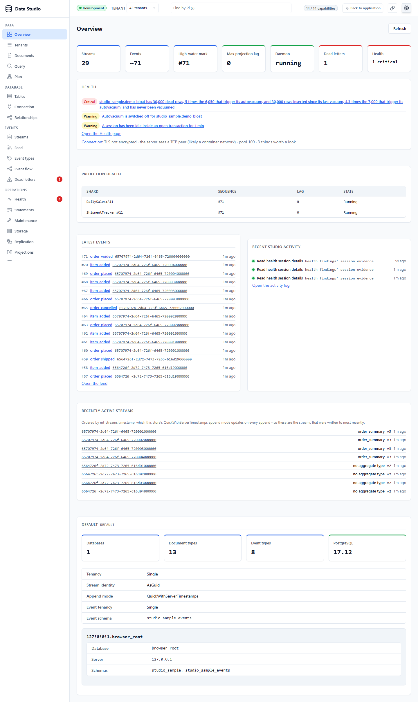](docs/screenshots/overview-light.png) | [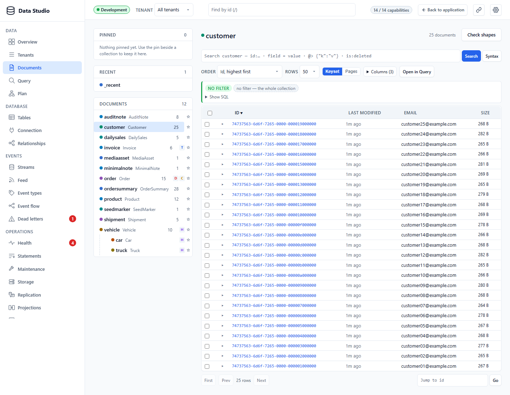](docs/screenshots/documents-list.png) |
| **Overview**: the store, its tenancy, stream identity and the databases behind it | **Documents**: collections, a `field:value` search and its index verdict |
| [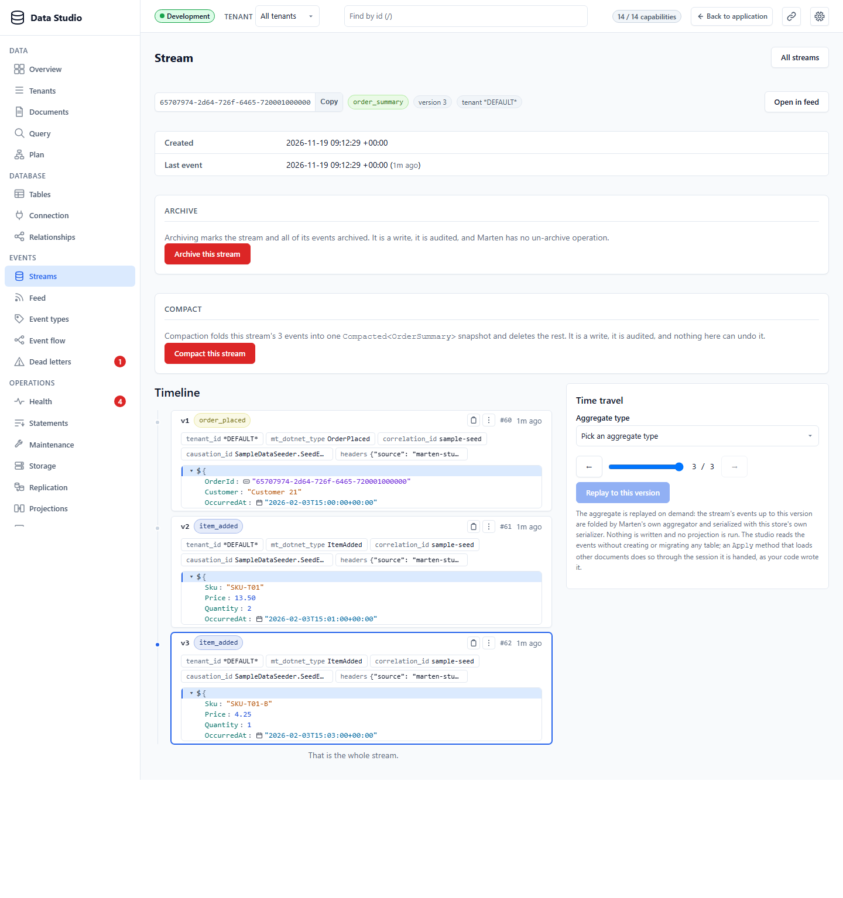](docs/screenshots/stream-detail.png) | [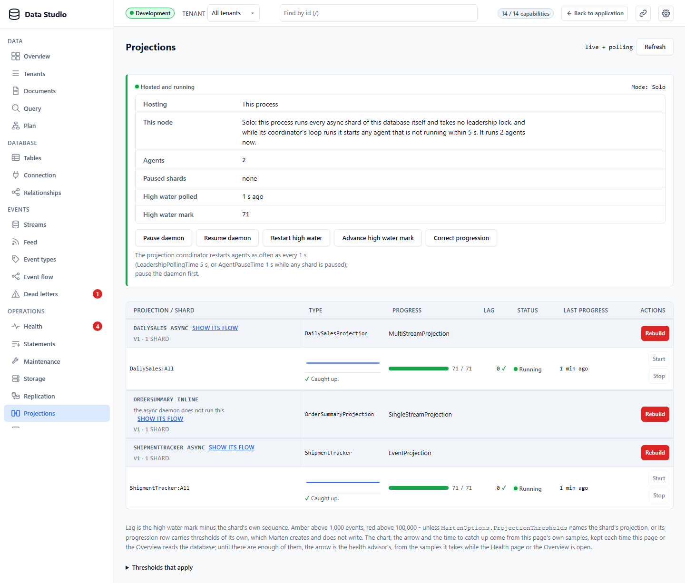](docs/screenshots/projections.png) |
| **A stream**: the timeline, each event's JSON and headers, and time travel beside it | **Projections and the async daemon**: shard state, progression and the high-water mark |

## Postgres

For any application that registers an `NpgsqlDataSource`, Marten or not: a health advisor that says what is wrong, how
sure it is and what to change; a database browser; sessions and locks; the statements that take the database's time;
autovacuum, storage and replication; foreign keys as a diagram; and a SQL console whose guard is a read-only transaction.
The findings are also available to your own code, with no UI, as `DataStudio.Postgres.Diagnostics`.

| | |
|---|---|
| [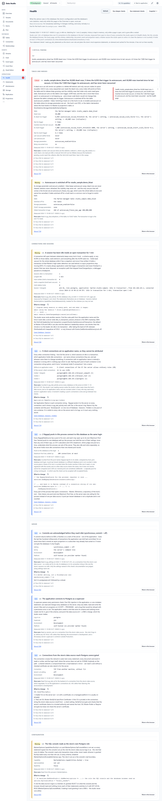](docs/screenshots/health.png) | [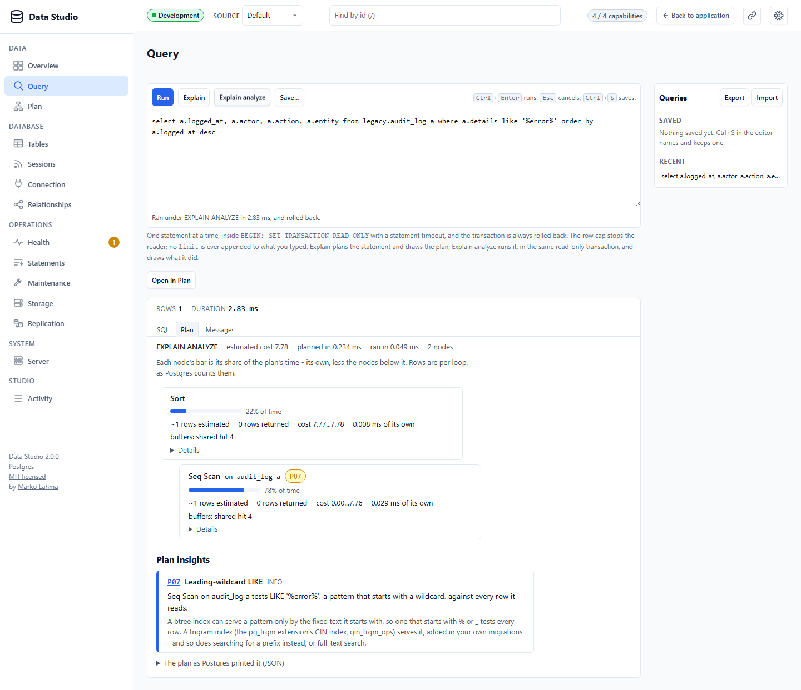](docs/screenshots/postgres-query-plan.png) |
| **Health**: findings by area, each with its evidence, how sure the advisor is and what to change | **Query**: a guarded SQL console that draws the plan and says what is wrong with it |
| [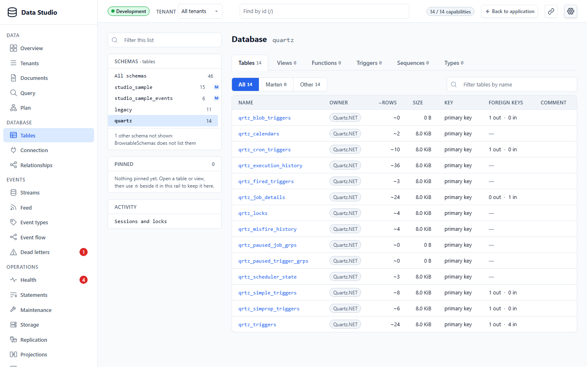](docs/screenshots/database-browser.png) | [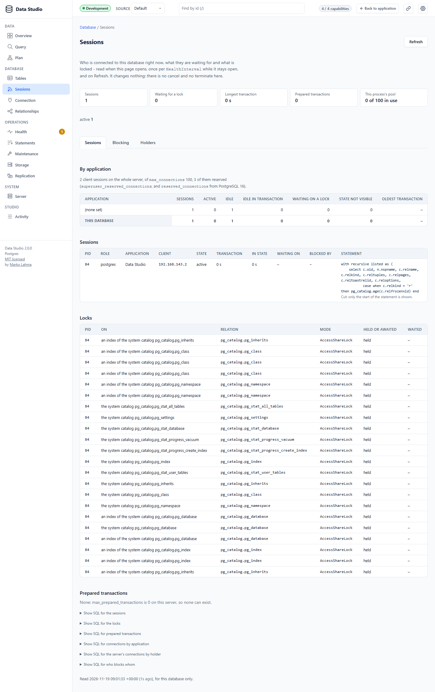](docs/screenshots/postgres-sessions.png) |
| **Database**: every table, view, function, trigger, sequence and type; here a Quartz.NET job store | **Sessions**: who is connected, what they run and what they wait for |

## Kafka

For the clusters, topics, partitions and consumer groups your application's own Kafka credentials can describe. Behind
capabilities that are off by default: search for records by key, header, CloudEvents attribute or JSON path, read values
with redaction rules applied before anything leaves the engine, export what you found and follow topics live. It never
creates a topic, never commits an offset and never joins a group.

| | |
|---|---|
| [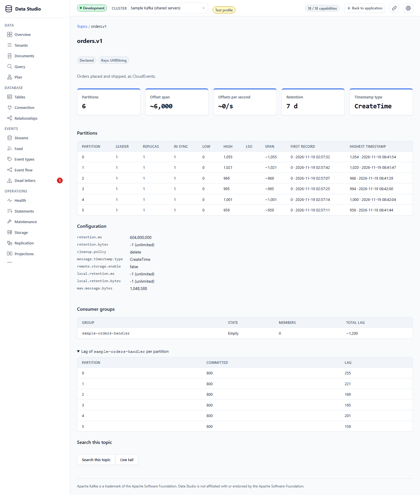](docs/screenshots/kafka-topic.png) | [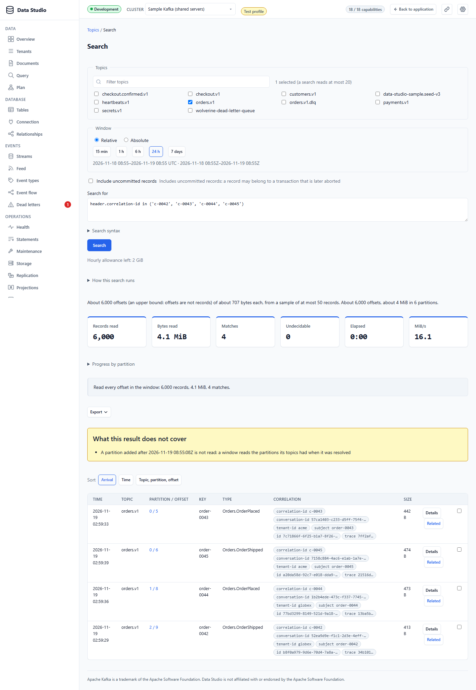](docs/screenshots/kafka-search.png) |
| **A topic**: partitions, watermarks, configuration and each consumer group's lag | **Search**: records by key, header, CloudEvents attribute or JSON path in a time window, with exactly what was read |
| [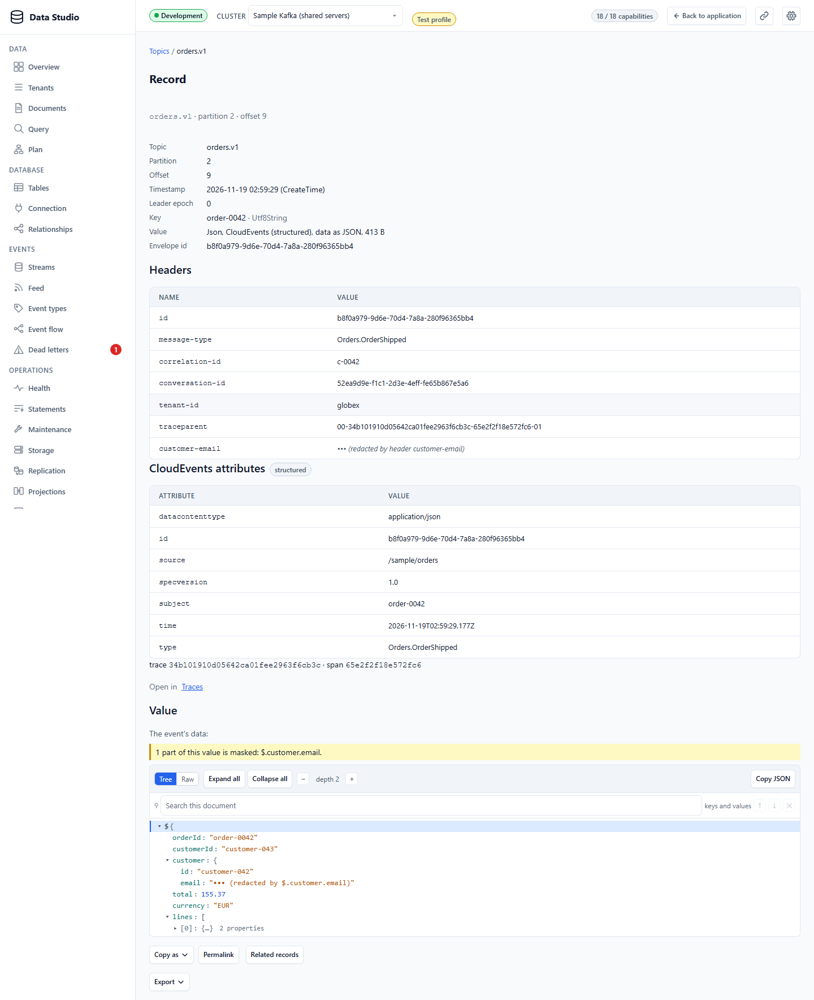](docs/screenshots/kafka-record.png) | [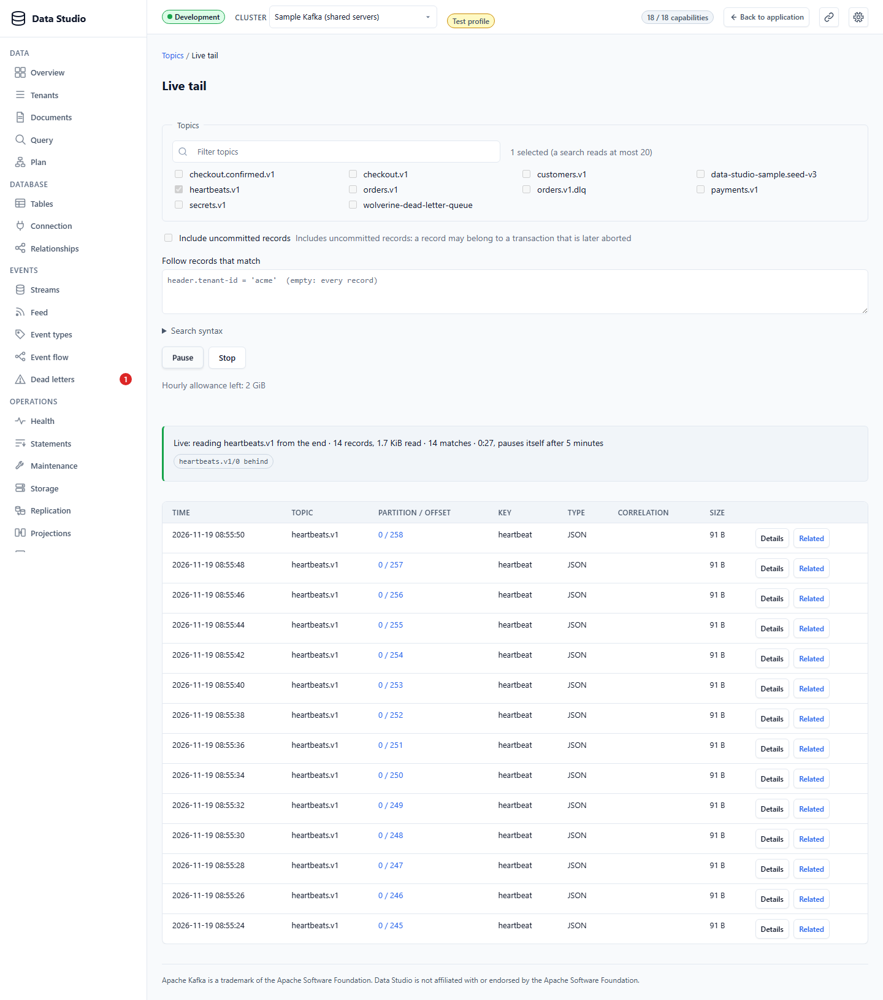](docs/screenshots/kafka-tail.png) |
| **A record**: key, headers, attributes and value, with the fields your rules redact masked | **Live tail**: records as they arrive, paused and resumed without losing its place |

Apache Kafka is a trademark of the Apache Software Foundation. Data Studio is not affiliated with or endorsed by the
Apache Software Foundation.

## Install

| Your application | Install |
|---|---|
| Uses Marten | `dotnet add package DataStudio.Marten --prerelease` <!-- beta: remove at 2.0.0 --> |
| Uses Npgsql with no Marten | `dotnet add package DataStudio.Postgres --prerelease` <!-- beta: remove at 2.0.0 --> |
| Uses only Kafka | `dotnet add package DataStudio.Kafka --prerelease` <!-- beta: remove at 2.0.0 --> |
| Uses Marten and Kafka | `dotnet add package DataStudio.Marten --prerelease`, then `dotnet add package DataStudio.Kafka --prerelease` <!-- beta: remove at 2.0.0 --> |
| Is a Wolverine application with Kafka | also `dotnet add package DataStudio.Kafka.Wolverine --prerelease` <!-- beta: remove at 2.0.0 --> |
| Wants only the health findings in its own code, with no UI | `dotnet add package DataStudio.Postgres.Diagnostics --prerelease` <!-- beta: remove at 2.0.0 --> |

Seven packages, released together at one version and pinned exactly to each other, so upgrade them together.
`DataStudio.Marten` brings `Marten` (floor `9.57.0`) and the Postgres module; `Npgsql` has floor `9.0.4` and
`Confluent.Kafka` floor `2.14.0`. PostgreSQL 15 to 19 are tested. What each package is and brings is in
[docs/setup.md](docs/setup.md#packages-and-modules).

## Quick start

```csharp
using DataStudio;
using DataStudio.Marten;

builder.Services
    .AddDataStudio()
    .AddMarten();          // or .AddPostgres(), and .AddKafka(kafka => kafka.AddCluster("primary", clientConfig))

// ...

app.MapDataStudio().RequireAuthorization();
```

The studio is then at `/studio`, read-only, behind whatever `RequireAuthorization()` means in your application. The
front page has one tile per module, in the order you added them, and each module's pages are under its own segment:
`/studio/marten`, `/studio/postgres`, `/studio/kafka`.

To let people change things, turn capabilities on and say who may use them:

```csharp
builder.Services
    .AddDataStudio(studio => studio.AuthorizationPolicy = "Studio")
    .AddMarten(marten =>
    {
        marten.WriteAuthorizationPolicy = "StudioWrite";
        marten.Capabilities = MartenCapabilities.All();   // a development box; pick them one by one elsewhere
    });
```

The full registration (compiled from the sample, so it cannot drift), every option, the opt-in ASP.NET Core health
check, tenancy and hosting notes are in [docs/setup.md](docs/setup.md).

### The first five minutes

- **Marten › Overview** and **Postgres › Health**: your stores and databases, and findings with the `StoreOptions` line
  or the statement that would change each one.
- **Documents**: a collection, a `field:value` search with its index verdict, a document's JSON and metadata.
- **Events**: a stream's timeline and time travel; **Event flow** shows which projections read which event types.
- **Query**: the clause box, the SQL console and LINQ mode keep recent and saved queries in your browser.
- **Kafka › Search**: pick a topic and a time window, then search by key, header or attribute.
- **Find by id** (the header box, `/` or Ctrl+K): paste a document id, a stream id, a table name or a queryid.
- Press `?` for every keyboard shortcut. **Activity** lists what was done through the studio in this process.

## Safe by default

- **Three layers of authorization, all yours.** Who gets in (`DataStudioOptions.AuthorizationPolicy`); which store,
  database, tenant, cluster or topic they see; and who may use each capability. The studio authenticates nobody, and a
  startup guard refuses a mapping that answered none of it.
- **Capabilities are off by default**, and `ReadOnly` turns them all off again whatever they say. Refusals live in the
  service layer, not in the markup, and every use is audited, failed or not.
- **The SQL console's guard is the transaction**: `SET TRANSACTION READ ONLY`, timeouts and an optional `SET LOCAL ROLE`.
  A read-only transaction is not a sandbox, so grant `RunSql` to people you would give `psql` to.
- **Secrets stay where they are.** A connection string is never shown, only its settings one by one; Kafka values are
  redacted inside the engine by rules you declare, before any page, export or log sees them.

More: [docs/authorization.md](docs/authorization.md), the threat model in [docs/security.md](docs/security.md), and the
short form with today's limits in [docs/limits.md](docs/limits.md).

## What it is not

Not a standalone application, not a fleet monitor and not a connection-string tool: there is no "point it at a database"
mode. [CritterWatch](https://jasperfx.net) is the Critter Stack's fleet console; pgAdmin is a general SQL client. Data
Studio is the local one between them: *this* process, *this* store, with your own configuration in front of you.

## More screenshots

| | |
|---|---|
| [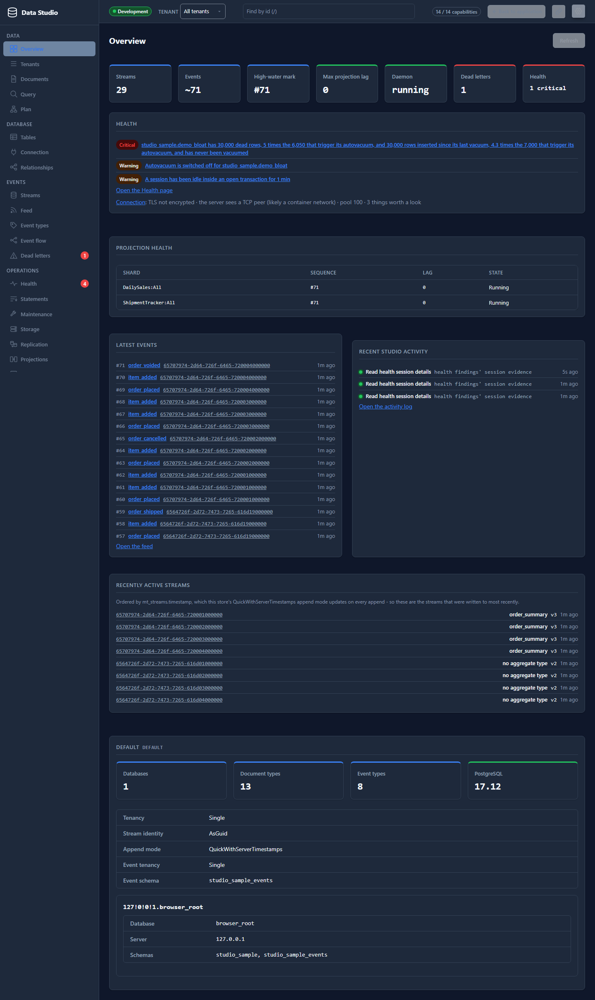](docs/screenshots/overview-dark.png) | [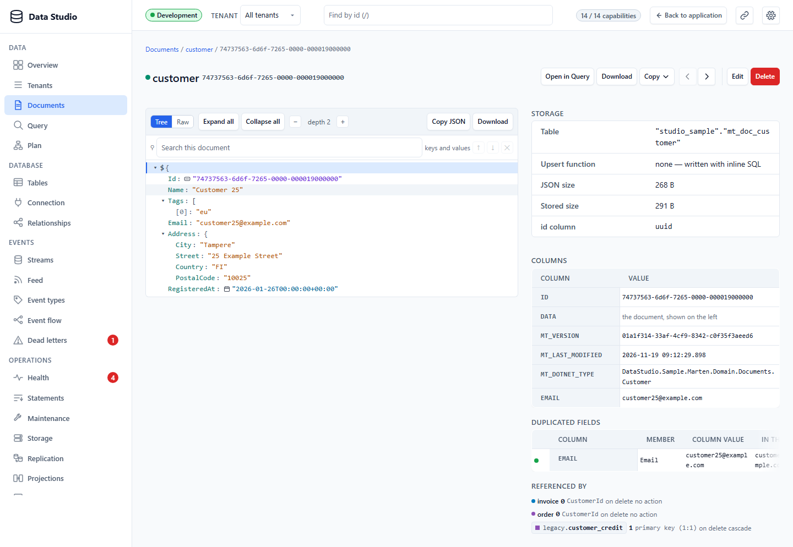](docs/screenshots/document-detail.png) |
| The dark theme, from the picker behind the gear button | One document: JSON on the left, what its metadata columns say on the right |
| [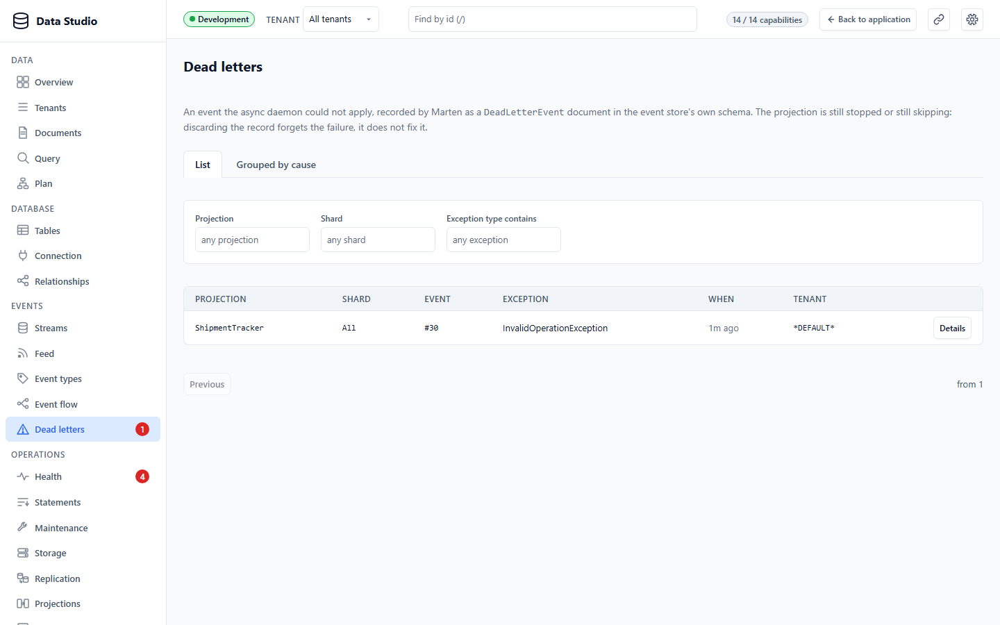](docs/screenshots/dead-letters.png) | [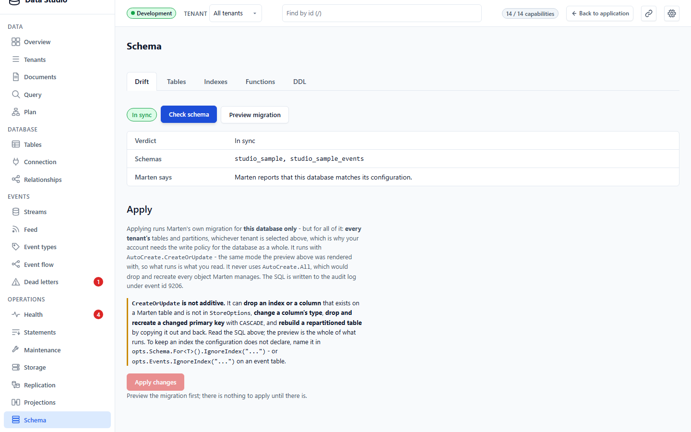](docs/screenshots/schema-drift.png) |
| Dead letters, expanded to the failing event and its exception | Schema: what Marten would change, before anything is applied |
| [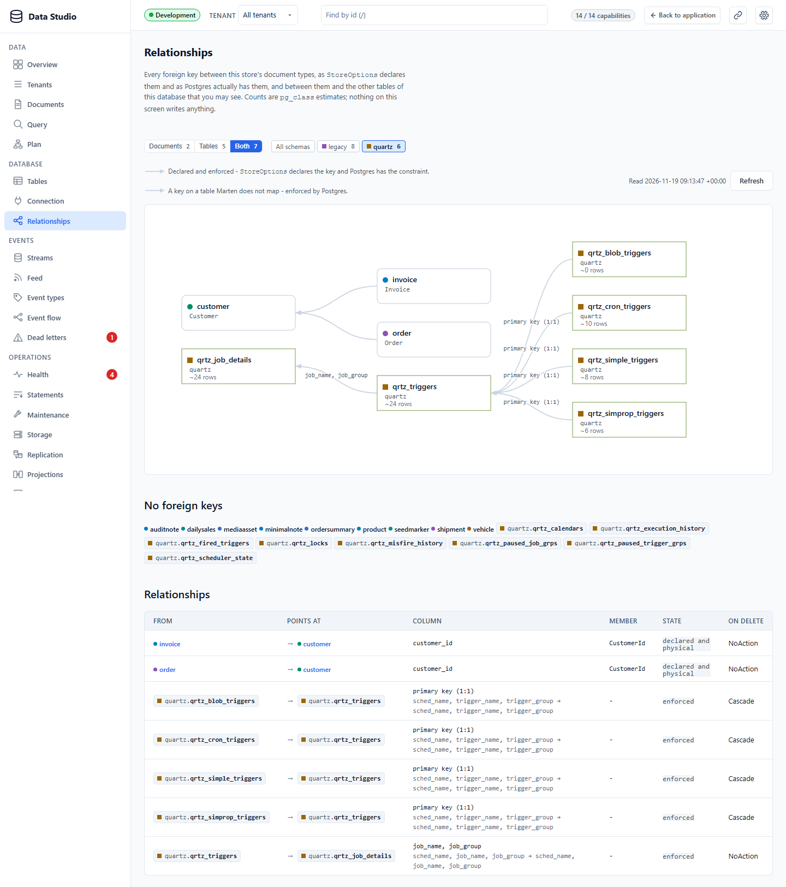](docs/screenshots/relationships-quartz.png) | [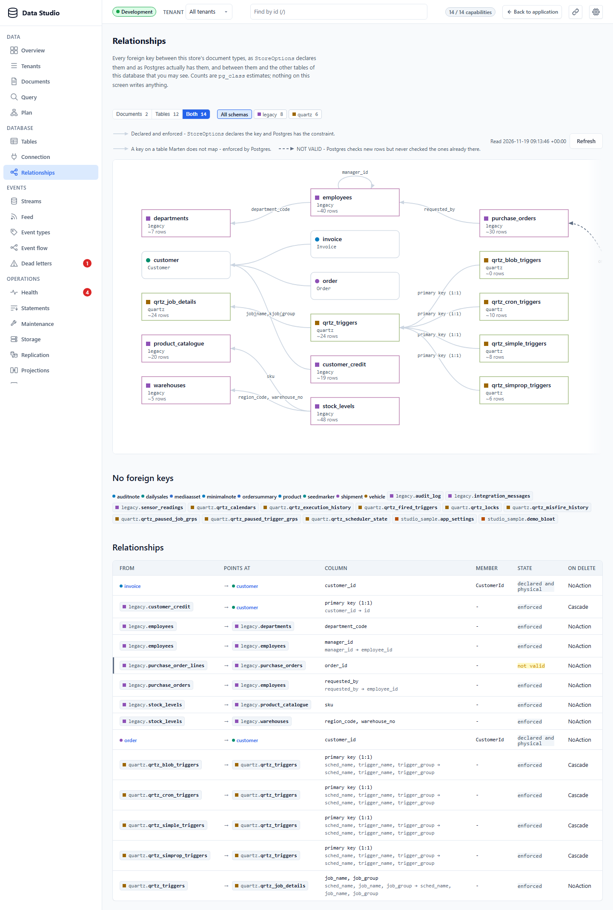](docs/screenshots/relationships.png) |
| Relationships over plain tables beside the document types | Relationships: the foreign keys `StoreOptions` declares, checked against the ones Postgres holds |
| [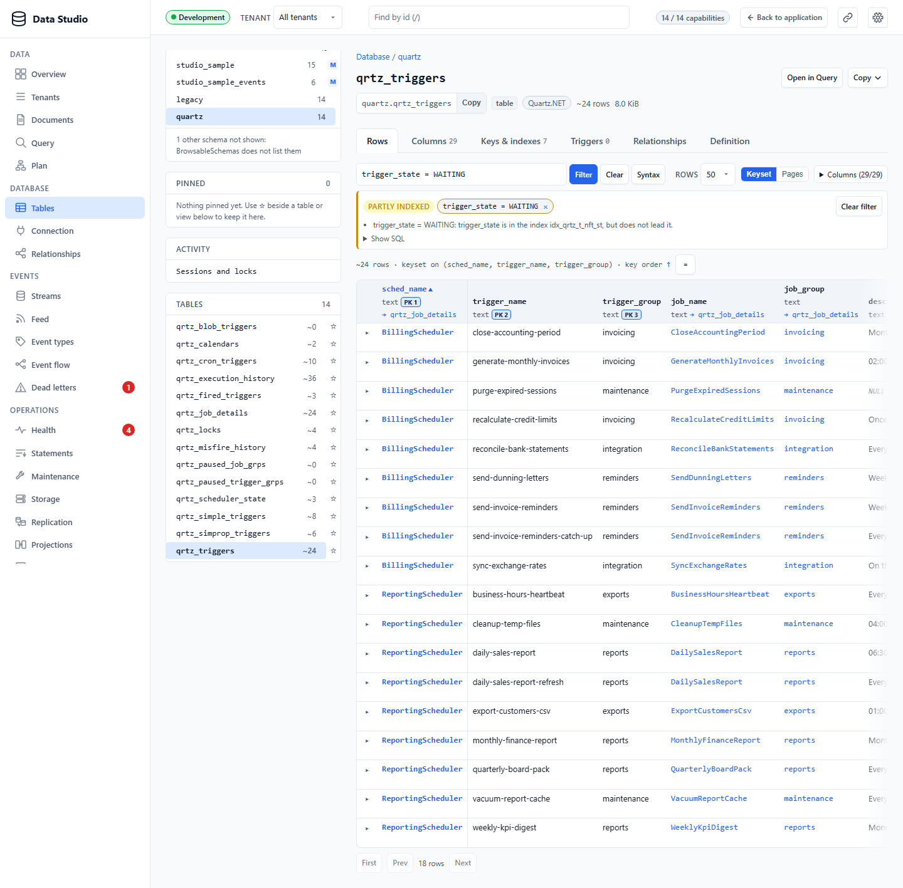](docs/screenshots/database-rows.png) | [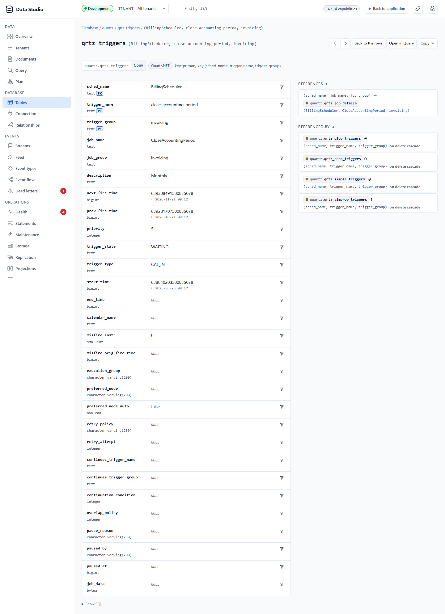](docs/screenshots/database-row-detail.png) |
| A table's rows: a filter with its index verdict, keyset paging and typed headers | One row: every column, what it points at and what points at it |
| [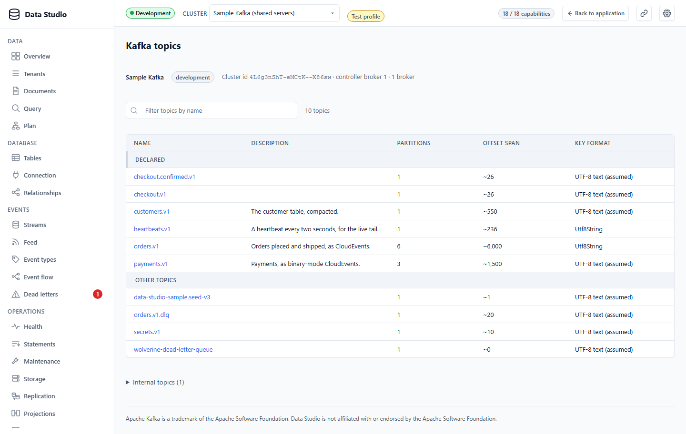](docs/screenshots/kafka-topics.png) | [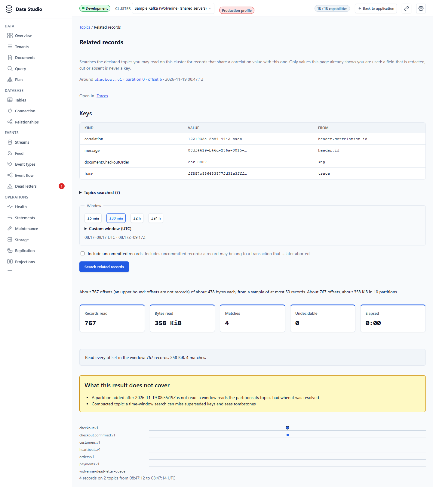](docs/screenshots/kafka-related.png) |
| Kafka: the topics the application's own credentials can describe | Kafka: the records related to one record across topics, by the correlation fields you declare |
| [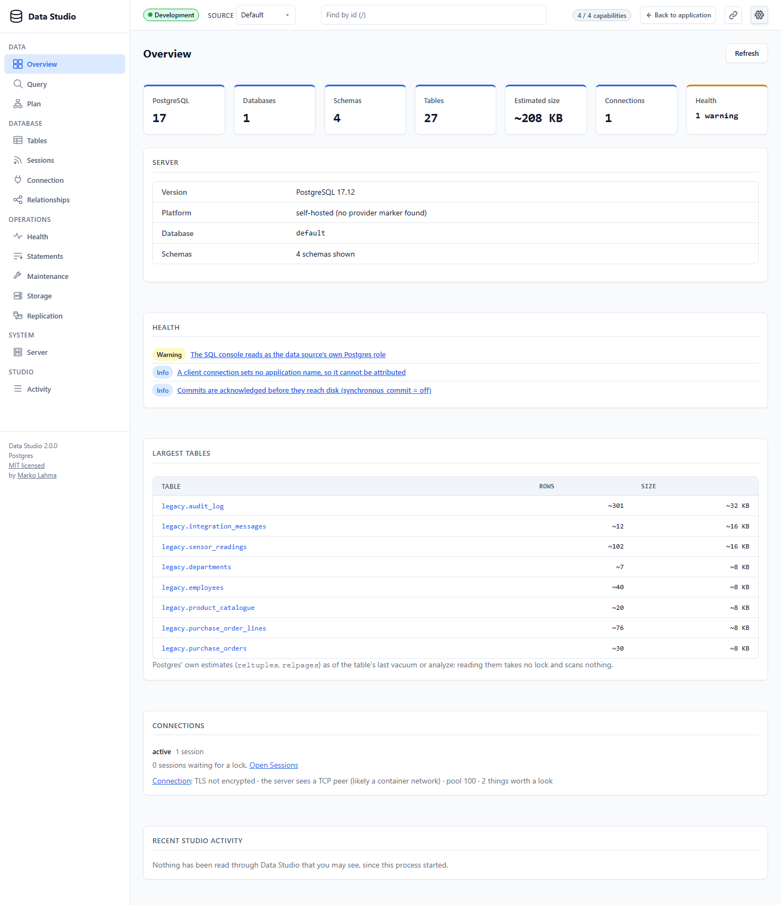](docs/screenshots/postgres-overview.png) | [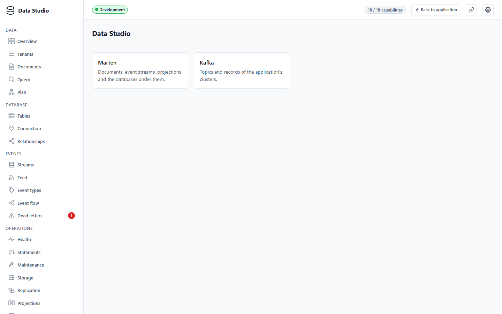](docs/screenshots/front-page.png) |
| The Postgres module alone, in a host with no Marten | The front page: one tile per module, in the order the host added them |

## Documentation

| | |
|---|---|
| [Setup](docs/setup.md) | Packages, registration, options, tenancy, hosting |
| [Authorization and capabilities](docs/authorization.md) | The three layers, the resources your policies are asked about, every capability |
| [Every screen](docs/screens.md) | What each page of each module shows |
| [Postgres module](docs/postgres.md), [health advisor](docs/health.md), [finding codes](docs/health/codes.md) | The database pages, the checks and their stable codes |
| [Kafka module](docs/kafka.md) | Clusters, topics, search, redaction, export, live tail, limits |
| [Diagnostics API](docs/diagnostics.md) | The findings in your own code, with or without the UI |
| [Security model](docs/security.md), [limits](docs/limits.md) | The threat model, and what Data Studio does not do yet |
| [LINQ mode](docs/linq-mode.md), [Connection page](docs/connection.md), [compaction](docs/compaction.md) | Single features in depth |
| [PostgreSQL versions](docs/postgres-versions.md), [Aurora](docs/aurora.md) | What is tested, and what differs on managed platforms |
| [Stability](docs/stability.md), [upgrading from 1.x](docs/upgrading.md), [changelog](CHANGELOG.md) | What is promised between releases |

## Try the samples

```shell
dotnet run --project samples/DataStudio.Sample.Marten
```

With Docker running and nothing configured, each sample starts throwaway containers, says so in a loud banner and seeds
demo data; none ever falls back to `localhost`. `samples/DataStudio.Sample.Kafka` shows Marten and Kafka side by side,
and `samples/DataStudio.Sample.Postgres` the Postgres module alone. Users, switches and what is seeded are in
[docs/sample.md](docs/sample.md).

## Building, versioning, contributing

`.\build.ps1 Test` builds and runs everything (the integration suites need Docker); details are in
[docs/building.md](docs/building.md). A release of any size may still break what a host compiles against, so pin the
version you tested: [docs/stability.md](docs/stability.md) says what is promised. To report a vulnerability, see
[SECURITY.md](SECURITY.md). [`AGENTS.md`](AGENTS.md) holds the rules and design decisions of this codebase; read it before
opening a pull request.

## License

MIT. See [LICENSE](LICENSE).
